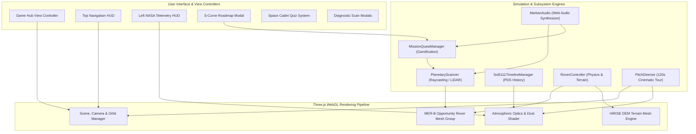

# 🏛️ 02. SYSTEM ARCHITECTURE & TECHNICAL DESIGN

## 1. Architectural Pattern & Design Philosophy

"Relics of the Red Dust" is engineered as a **Modular Event-Driven Client-Side WebGL Architecture**. It enforces strict separation of concerns between:
1. **The 3D Scene & Rendering Engine** (`src/renderer/`)
2. **Interactive Simulation Systems & Subsystems** (`src/systems/`)
3. **Scientific & Bilingual Educational Data Repositories** (`src/data/`)
4. **DOM & HUD Glassmorphic User Interface** (`index.html`, `style.css`, `src/main.js`)



---

## 2. 3D WebGL Rendering Pipeline

### 2.1 HiRISE Digital Elevation Model (DEM) Terrain Engine (`src/renderer/terrain.js`)
The Martian terrain model replicates Perseverance Valley along the rim of Endeavour Crater using procedural multi-frequency height functions:
$$Z(x, y) = A_1 \sin(0.08x)\cos(0.08y) + A_2 \sin(0.03x + 0.04y) + \text{CraterRim}(x, y) + \text{PerlinNoise}(x, y)$$

- **Resolution**: $180 \times 180$ vertex grid plane geometry with dynamic smooth normals.
- **Surface Material**: MeshStandardMaterial with high roughness (0.88), customized rust-red color (`#a64a2b`), and canvas-generated procedural dust textures with rock scatter geometries.

### 2.2 Procedural Opportunity Rover 3D Mesh (`src/renderer/rover.js`)
The Opportunity 3D model is constructed with authentic mechanical sub-assemblies:
- **Warm Electronics Box (WEB)**: Anodized aluminum / gold Kapton body chassis.
- **Solar Array Panels**: Procedural canvas grid texture representing photovoltaic cells with dynamic dust layer opacity tinting.
- **Pancam & Navcam Mast**: Dual-stereo masthead with rotational articulators.
- **Instrument Deployment Device (IDD Robotic Arm)**: 3-DOF articulated arm equipped with:
  - **Rock Abrasion Tool (RAT)**: Diamond-matrix grinding bit.
  - **Mössbauer Spectrometer (MIMOS II)**: Iron-oxidation sensor.
  - **Alpha Particle X-Ray Spectrometer (APXS)**: Elemental detector.
- **Rocker-Bogie 6-Wheel Suspension**: Procedural cylindrical wheels with articulated rocker linkages for terrain compliance.
- **Master Solid-State Memory Core (2085 Artifact)**: Glowing cyan memory cartridge for the final narrative transmission.

---

## 3. Atmospheric Optical Physics Model (Sol 5111)

### 3.1 The Beer-Lambert Extinction Law Implementation
The atmospheric simulation implements the standard planetary science Beer-Lambert extinction formula:
$$I(\tau) = I_0 \cdot e^{-\tau \cdot m}$$
Where:
- $\tau$: Atmospheric optical depth (Optical Tau, range: $0.5 \le \tau \le 10.8$).
- $m$: Air mass factor (nominally $1.0$ at solar zenith).
- $I_0$: Unattenuated top-of-atmosphere solar irradiance.

```javascript
// src/renderer/atmosphere.js
const extinction = Math.exp(-tau / 1.0);
const extinctionPercent = (1 - extinction) * 100;

// Power Generation (Wh/sol)
const simulatedPower = Math.max(18, Math.min(900, Math.round(900 * Math.exp(-tau / 0.82))));
```

### 3.2 Visual Atmosphere Shader Adjustments
- **Sky Color**: Transitions from Martian Butterscotch/Amber (`#d99058` at $\tau=0.8$) to dark abyssal storm brown (`#180a04` at $\tau=10.8$).
- **Sun Disc Visibility**: Sun disc mesh scales down and fades opacity to 0 when $\tau \ge 8.0$.
- **Fog Density**: Exponential squared fog density $\rho(\tau) = 0.015 + 0.075 \cdot (\frac{\tau}{10.8})$.
- **Solar Dust Deposition**: Procedural canvas opacity overlay on rover solar cells increases from 0% to 94%.

---

## 4. Subsystem Architectures

### 4.1 Planetary LiDAR Scanner (`src/systems/scanner.js`)
- Uses Three.js `THREE.Raycaster` projecting from mouse/touch screen normalized device coordinates (NDC) to 3D world vectors.
- Interactive objects are tagged via `userData.subsystemId` and `userData.isArtifactBeacon`.
- Features an animated 3D concentric holographic laser reticle ring that snaps to target surface geometry.

### 4.2 Mission Quest & Gamification Manager (`src/systems/quests.js`)
- Maintains reactive completion state set (`completedMissions`).
- Emits celebratory confetti bursts (via `canvas-confetti`) upon mission completion.
- Renders the custom **S-Curve Cosmic Roadmap Canvas** with SVG path calculations and dynamic node states (`Locked`, `Active`, `Completed`).
- Direct action callbacks seamlessly bridge roadmap clicks to 3D scene camera transitions and scanner executions.

### 4.3 Martian Web Audio Synthesizer Engine (`src/systems/audio.js`)
Built entirely on the Web Audio API with zero external audio file downloads:
- **Atmospheric Wind Soundscape**: White noise buffer routed through a dynamic resonant Biquad Bandpass Filter whose frequency and gain scale with Tau ($\tau$).
- **Telemetry Data Chirp**: Frequency-modulated oscillator emitting authentic NASA telemetry beeps.
- **Decoded Morse Code Transmission**: Synthesized audio stream generating the last words of Opportunity.
