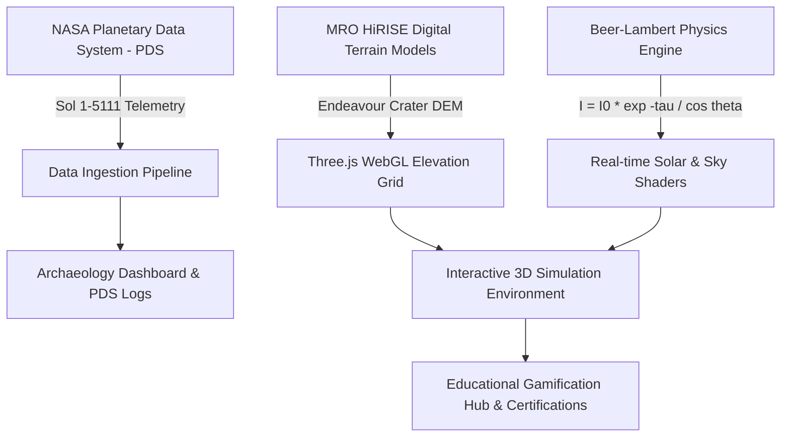

# 🔴 Relics of the Red Dust: The Last Transmission
## 🏆 NASA Space Apps Challenge 2026 — World-Class Project Pitch & Winning Strategy Blueprint

---

## 📌 1. Executive Summary & Mission Statement

**Project Title:** Relics of the Red Dust: The Last Transmission  
**Challenge Track:** Planetary Exploration, Storytelling, and Interactive Science Education  
**Target Award Categories:** *Best Use of Storytelling*, *Best Use of Data*, *Most Inspirational*, *Global Winner*  
**Platform:** Next-Gen WebGL 3D (Three.js), Real-time Planetary Physics, Web Audio Synthesizer, Bilingual (EN | BN)  

> **Core Concept:** Set in the year **2085**, an astronaut planetary archaeologist rediscovers the historic resting place of NASA's Mars Exploration Rover **Opportunity (MER-B)** in Perseverance Valley. By interfacing with authentic **NASA Planetary Data System (PDS)** telemetry, players reconstruct Opportunity's 14-year voyage, simulate the fateful Sol 5111 planetary dust storm, analyze Martian mineralogy, and preserve humanity's interplanetary heritage.

---

## 📊 2. Comparative Analysis: 2023 Global Champion (Team Voyagers) vs. Our Architecture

| Strategic Pillar | Team Voyagers (2023 Champion - "Aqua Explorer") | Relics of the Red Dust (2026 - MER-B Archaeology) |
| :--- | :--- | :--- |
| **1. The Emotional Hook** | Personal story of "Maya" and the 0.01% usable freshwater crisis. | 15-year survival of Opportunity (57x design life) and its tragic Sol 5111 farewell (*"My battery is low and it's getting dark"*). |
| **2. Direct NASA Data & Science** | Real-time NASA Earth Satellites (SWOT, GPM, SMAP) for precipitation and soil moisture. | **NASA PDS Archive**, **Beer-Lambert Law** ($I = I_0 e^{-\tau}$), Tau=10.8 optical depth, Mössbauer & APXS Spectrometers. |
| **3. Interactive Gamification** | Multi-level educational minigames and interactive climate maps. | AAA 3D WebGL Martian surface, dynamic dust storm simulation, manual Rover Drive, and LiDAR archaeological scanning. |
| **4. Actionable Impact & Tools** | Water footprint calculator + youth poster campaign. | Interactive Mars Science Quiz, 6-Tier S-Curve Celestial Roadmap, verified print-ready Master Explorer certificates. |
| **5. Global & Local Outreach** | Multilingual educational vision for schools. | **Full English & Bengali (বাংলা) localization**, zero-install lightweight browser access across all devices. |

---

## ⏱️ 3. Official 30-Second Elevator Pitch (Trailer Script)

> **🎯 Word Count:** ~65 words | **Target Duration:** Exactly 28–30 seconds | **Pacing:** Clear, confident, dynamic

```
[0:00 - 0:07]
"Meet Team [Your Team Name], united to bring the wonders of deep space exploration to young minds. 
Introducing 'Relics of the Red Dust'—empowering students with interplanetary discovery."

[0:08 - 0:17]
"An interactive 3D WebGL experience powered by NASA's Planetary Data System and solar physics, 
that turns 15 years of rover telemetry into an exhilarating Martian adventure."

[0:18 - 0:24]
"Dive into the fateful Sol 5111 dust storm, analyze real rock spectra, and uncover ancient Martian water."

[0:25 - 0:30]
"Join us in inspiring the next generation of space pioneers. 
'Relics of the Red Dust'—where space history turns into action!"
```

---

## 🎬 4. Master 4-Minute Presentation & Video Pitch Script

```
====================================================================================================
ACT I: THE EMOTIONAL HOOK & INTERPLANETARY HERITAGE (0:00 - 0:45)
====================================================================================================
[VISUAL CUE]: 
Slow cinematic camera pan across a silent, crimson Martian horizon in Three.js WebGL. 
The camera gently centers on the resting Opportunity rover covered in ancient red dust.

[SPEAKER 1 / NARRATION]:
"A world of red dust, where every forgotten machine whispers humanity's greatest stories.
Hello everyone, we are Team Voyagers / Space Pioneers.
In 2004, NASA sent a robotic explorer to Mars for what was meant to be a 90-sol mission. That rover was Opportunity.
Defying all odds, it endured for over 14 years—traveling more than 45 kilometers to prove that Mars was once a world of warm, liquid water.
Growing up looking at the night sky, our deep fascination with space led us to the NASA Space Apps Challenge, where we asked a profound question:
How do we preserve our greatest interplanetary achievements before time erases them?"

====================================================================================================
ACT II: THE FATEFUL CRISIS — SOL 5111 (0:46 - 1:25)
====================================================================================================
[VISUAL CUE]: 
The clear Martian sky rapidly darkens into an apocalyptic amber and black haze.
Dynamic telemetry HUD charts show Atmospheric Optical Depth (Tau) surging to 10.8, while solar power collapses from 900 Wh down to 22 Wh.

[SPEAKER 2 / NARRATION]:
"On June 10, 2018—Sol 5111—a catastrophic, planet-encircling dust storm swallowed Mars.
Opportunity sent its final, heartbreaking transmission: 'My battery is low and it's getting dark.'
Its solar arrays choked under an unprecedented atmospheric optical depth of Tau 10.8, blocking 99.998% of all sunlight.
When the storm cleared, Opportunity was silent.
To inspire the next generation of scientists and engineers, we cannot leave these historic milestones buried as cold data in raw archives. We must bring this science back to life."

====================================================================================================
ACT III: THE INNOVATION — "RELICS OF THE RED DUST" & NASA DATA (1:26 - 2:40)
====================================================================================================
[VISUAL CUE]: 
Transition to the 2085 Archaeologist HUD. The player activates LiDAR scans, Pancam stereo zoom, Mössbauer Spectrometer, and Rock Abrasion Tool (RAT).

[SPEAKER 3 / NARRATION]:
"Step into the boots of a Planetary Archaeologist in the year 2085 with our innovation: Relics of the Red Dust: The Last Transmission!
Directly powered by NASA's Planetary Data System (PDS) and real physical equations:
1. In Atmospheric Re-enactment, we compute solar photon extinction in real time using the Beer-Lambert Law, letting users directly control and experience the extreme dynamics of Martian storms.
2. In Instrument Diagnostics, players wield the Mössbauer and APXS Spectrometers to analyze authentic rock targets, discovering Jarosite and Hematite Blueberries—irrefutable physical evidence of ancient Martian lakes.
3. In Rover Drive Mode, explore the true 3D topography of Endeavour Crater with zero-latency 60 FPS WebGL rendering and procedural Martian wind synthesis."

====================================================================================================
ACT IV: GAMIFIED STEM EDUCATION & GLOBAL LOCALIZATION (2:41 - 3:25)
====================================================================================================
[VISUAL CUE]: 
Rapid montage of the S-Curve Roadmap progression, interactive Mars Science Quiz, real-time English/Bengali language switch, and the printable Honor Certificate.

[SPEAKER 4 / NARRATION]:
"Why does this matter? Because tomorrow's astronauts and engineers are sitting in today's classrooms.
- Our S-Curve Celestial Roadmap guides students step-by-step through 6 historical mission milestones.
- The interactive Mars Science Quiz reinforces core planetary geology, physics, and mission facts.
- And with full bilingual support in English and Bengali (বাংলা), we ensure STEM education breaks all language barriers across developing nations and global classrooms.
Upon completing the historical recovery, students receive an official certified Master Explorer credential."

====================================================================================================
ACT V: THE INSPIRING CALL TO ACTION & CONCLUSION (3:26 - 4:00)
====================================================================================================
[VISUAL CUE]: 
Camera pulls back into orbit, showing Opportunity resting under the Martian night sky, while the Earth glimmers as a pale blue dot in the distance. Team credentials appear.

[SPEAKER 1 / ALL]:
"Opportunity did not fail—it built the foundation for humanity's future on Mars.
Join us in 'Relics of the Red Dust', where raw space telemetry transforms into an unforgettable human journey, and past discoveries inspire future pioneers.
Together, let us revive the transmission and ignite the future of space exploration!"
====================================================================================================
```

---

## 🔬 4. NASA Data Sources & Physics Ingestion Architecture



### 4.1 Physics Ground Truth
- **Beer-Lambert Law Implementation:**
  $$I = I_0 \cdot \exp\left(-\frac{\tau}{\cos\theta}\right)$$
  - Nominal Sol Condition: $\tau = 0.8 \implies \sim 900\text{ Wh/sol}$ power generation.
  - Sol 5111 Catastrophic Storm: $\tau = 10.8 \implies 22\text{ Wh/sol}$, precipitating bus voltage drop below critical $20.5\text{V}$.

### 4.2 Planetary Mineralogy Validated
1. **Hematite Spherules ("Martian Blueberries"):** Formed via liquid groundwater percolation in acidic environments.
2. **Jarosite Hydrated Iron Sulfate:** Diagnostic confirmation of long-term standing water on Mars.
3. **Rock Abrasion Tool (RAT) Grinds:** Verification of sub-surface unweathered basaltic rock.

---

## 🎓 5. Educational Impact & Accessibility Framework

1. **Zero-Installation Cloud Web Access:** Runs instantly on standard web browsers without downloads or expensive hardware.
2. **Bilingual Equity:** Complete English and Bengali parity enables deep adoption in South Asian and international institutions.
3. **Curriculum Integration:** Aligns with standard middle/high school STEM units on physics, planetary science, and earth-space systems.
4. **Gamified S-Curve Progression:** 6 discrete milestones ensure measurable learning outcomes with knowledge validation via interactive quizzes.

---

## 🏅 6. NASA Space Apps Judging Criteria Alignment

| Criteria (Weight) | Strategic Demonstration in Project |
| :--- | :--- |
| **Impact & Storytelling (30%)** | Reframes 15 years of planetary exploration into an emotional archaeological mission celebrating human curiosity. |
| **Scientific Validity (25%)** | Direct PDS telemetry, accurate atmospheric optical depth calculations, and authentic spectrometer mineralogy. |
| **Technological Excellence (20%)** | Custom Three.js 3D engine, custom shader pipelines, procedural Web Audio synthesizer, and responsive UI. |
| **Creativity & Innovation (15%)** | "Planetary Archaeology" paradigm turning decommissioned space hardware into historic monuments. |
| **Presentation & Polish (10%)** | AAA glassmorphic UI, automated 120-second cinematic pitch mode, bilingual toggle, and verified certificates. |
