# Relics of the Cosmic Dust

### Abandoned but Not Forgotten — an interactive 3D story about NASA's discarded equipment on the Moon, Mars and in deep space

**2026 NASA International Space Apps Challenge · Team Relics**

| | |
| :-- | :-- |
| **Challenge** | Abandoned but Not Forgotten: Storytelling About NASA's Discarded Equipment on the Moon and Mars |
| **Theme** | The Next Frontier (2026) |
| **Difficulty** | Beginner / Youth (also suitable for Intermediate learners) |
| **Subjects** | Astrophysics · Planets & Moons · Space Exploration |
| **Format** | Interactive web-based 3D educational game (HTML, CSS, JavaScript, WebGL) |
| **Audience** | School-age space enthusiasts, ages 8–16, plus teachers and parents |
| **Languages** | English and Bengali (বাংলা), switchable at any time |
| **Screenshots** | All figures in this document are captured from the current build of the game |

---

## Table of Contents

1. [Project Summary](#1-project-summary)
2. [Project Demonstration](#2-project-demonstration)
3. [Project Details — the WHY, the WHAT and the HOW](#3-project-details--the-why-the-what-and-the-how)
   - 3.1 [The WHY — what problem we are solving](#31-the-why--what-problem-we-are-solving)
   - 3.2 [The WHAT — the game in one page](#32-the-what--the-game-in-one-page)
   - 3.3 [A guided tour of the game](#33-a-guided-tour-of-the-game)
   - 3.4 [The hardware we tell stories about](#34-the-hardware-we-tell-stories-about)
   - 3.5 [Science you can feel — the learning mechanics](#35-science-you-can-feel--the-learning-mechanics)
   - 3.6 [Designing for children — "nothing happens automatically"](#36-designing-for-children--nothing-happens-automatically)
   - 3.7 [The HOW — architecture and implementation](#37-the-how--architecture-and-implementation)
   - 3.8 [Testing and quality](#38-testing-and-quality)
   - 3.9 [Impact, community and future work](#39-impact-community-and-future-work)
4. [Responses to the Challenge Considerations](#4-responses-to-the-challenge-considerations)
5. [Tools and Technologies](#5-tools-and-technologies)
6. [Use of Artificial Intelligence](#6-use-of-artificial-intelligence)
7. [NASA Data, Resources and Space Agency References](#7-nasa-data-resources-and-space-agency-references)
8. [Team](#8-team)
9. [How to Run the Project](#9-how-to-run-the-project)

---

## 1. Project Summary

For more than sixty years NASA has left machines behind: landers and descent stages on the Moon, rovers and stations on Mars, and probes that are still flying away from the Sun. Children usually hear about missions that are *active today*. The older machines are rarely mentioned, or they are dismissed as "space junk".

**Relics of the Cosmic Dust** turns those machines into the heroes of a playable story. The player is a young *Planetary Archaeologist* working in the year 2085. Their job is to revisit the places where humanity left hardware behind, find each relic, scan it, and uncover **what it was built to do, what it discovered, and why it was left there**.

Instead of reading a list of facts, the child:

- **drives a rover** across the Moon and Mars toward a glowing beacon;
- **chooses when to scan** a relic and sees the discovery in plain language;
- **tilts and inspects Voyager 1** in deep space, 24.3 billion km from Earth;
- **runs four interactive science labs** (rocket staging, X-ray spectroscopy, seismology, deep-space telemetry);
- **earns Cosmic Dust, Gems, XP, badges and a Master Certificate**.

The message the game is built to leave behind is one sentence:

> *"When we leave something behind on the Moon or Mars, it is not 'space junk' — it is a permanent monument to human curiosity."*

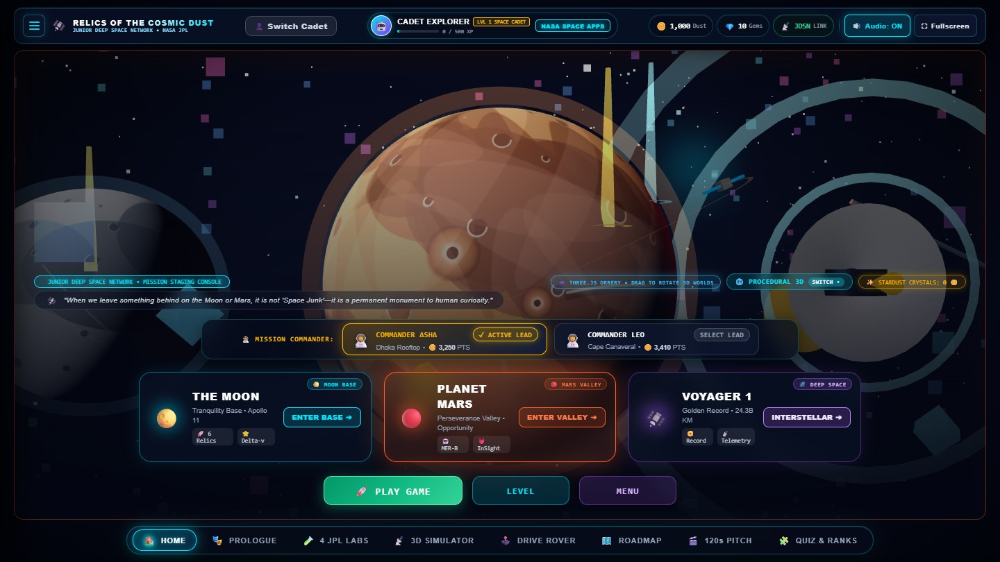

*Figure 1 — The Mission Control Hub. Three large gateways lead to The Moon, Planet Mars and Voyager 1. The background is a live, draggable 3D orrery.*

---

## 2. Project Demonstration

| Item | Where |
| :-- | :-- |
| Playable web game | Run locally with `npm install` then `npm run dev` (see [Section 9](#9-how-to-run-the-project)); opens at `http://localhost:3000` |
| Source code | This repository (`src/`, `index.html`, `style.css`) |
| Pitch video script and production blueprint | `docs/project/06_OFFICIAL_PRODUCTION_BLUEPRINT_AND_VIDEO_SCRIPT.md` |
| Project documentation | `docs/project/` (Markdown, DOCX and PDF versions) |

> Public links (hosted demo, repository and video) are added to the submission form at hand-in time.

---

## 3. Project Details — the WHY, the WHAT and the HOW

### 3.1 The WHY — what problem we are solving

The challenge asks for a story that "introduces school-age space enthusiasts to the hardware and the science it made possible". We identified four obstacles that stop children from engaging with this history:

| Obstacle | What children experience today | How the game answers it |
| :-- | :-- | :-- |
| **Dense sources** | Mission archives are long technical pages and tables. | Every fact is delivered through an action: drive, scan, tilt, balance, align. |
| **Active missions get all the attention** | Retired hardware is invisible or called "junk". | Retired hardware is the *protagonist*; the player is the archaeologist who rediscovers it. |
| **Passive formats** | Videos and slides are watched, then forgotten. | The child controls the camera, the rover and every discovery moment. |
| **Language and device barriers** | Most space content is English-only and needs a strong computer. | Full English/Bengali switch; runs in a normal browser with no install. |

Our central idea, **Planetary Archaeology 2085**, reframes the debate. In 2085 the landing sites are heritage monuments. The player is not cleaning up litter — they are *reading history from the objects themselves*.

### 3.2 The WHAT — the game in one page

| Layer | What it is |
| :-- | :-- |
| **Story frame** | A cadet of the *Junior Deep Space Network (JDSN)* in 2085, guided by two mission commanders: **Asha** (Dhaka, Bangladesh) and **Leo** (Cape Canaveral, Florida). |
| **Three worlds** | **The Moon** (Tranquility Base), **Mars** (Perseverance Valley) and **Deep Space** (Voyager 1). |
| **Companions** | Three selectable robot buddies: Astro-Bot "Echo", Cyber-Kitty "Nova", Rover-Drone "Orion". |
| **Progression** | A 6-level roadmap per world with XP, Cosmic Dust, Gems, badges, a quiz and a Master Certificate. |
| **Science labs** | Four hands-on JPL-style workbenches. |
| **Profiles** | Multiple cadets can share one device; each keeps independent progress. |

### 3.3 A guided tour of the game

#### Step 1 — Start screen and onboarding

A new visitor always starts on the Start Game screen. After pressing start, a five-step expedition briefing explains the story, shows a short video, introduces the companion bots and previews the levels. The briefing can be switched to Bengali at any step.

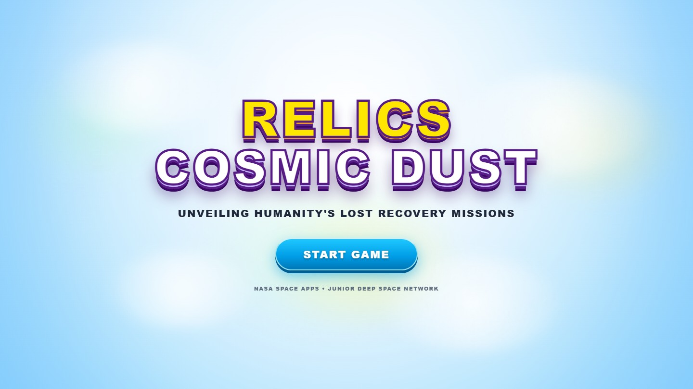

*Figure 2 — The Start Game screen shown to every new visitor and after logout.*

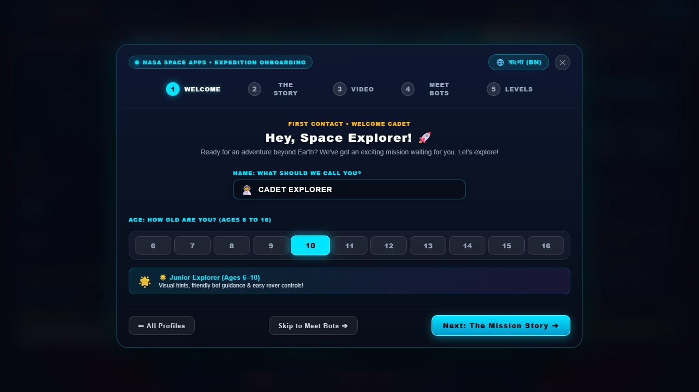

*Figure 3 — Onboarding step 1–2: the premise — robotic pioneers left behind, and the player's mission to find them.*

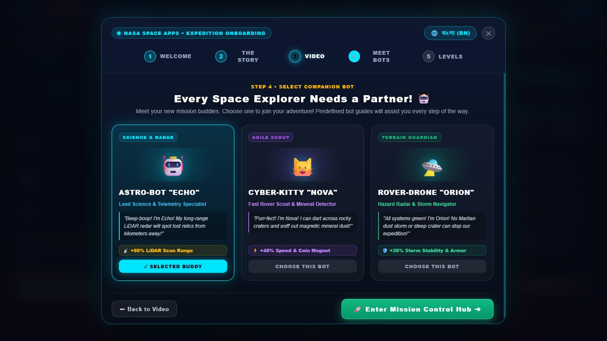

*Figure 4 — Onboarding step 4: choose a companion. Each bot has a different strength (+50% LiDAR range, +40% speed and coin magnet, or +35% storm stability).*

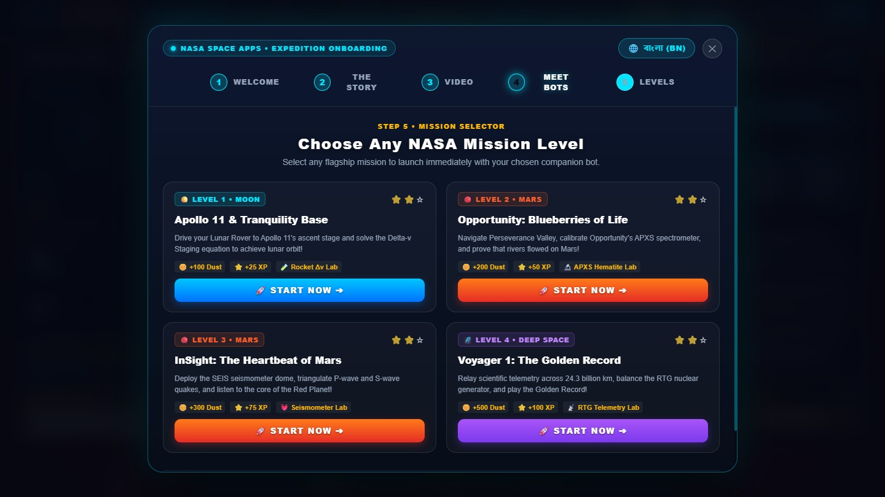

*Figure 5 — Onboarding step 5: a preview of the levels the cadet will unlock.*

#### Step 2 — The Mission Control Hub

The hub is designed to be understood by a child in seconds: **three big destination cards**, a one-line commander switcher, and three large buttons (**Play Game**, **Level**, **Menu**). Hovering a destination makes the 3D background fly to that world.

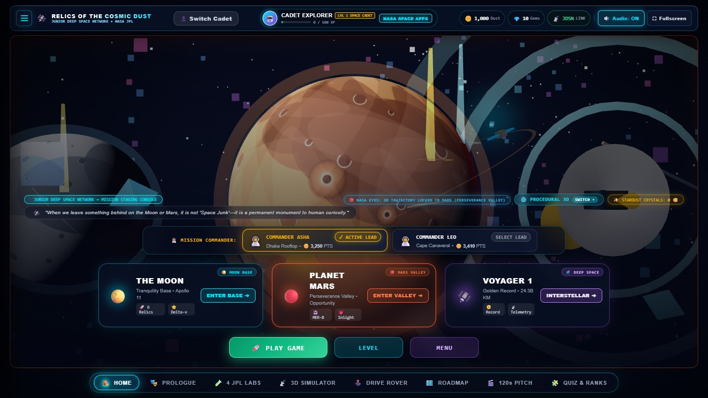

*Figure 6 — Hover effect: pointing at "Planet Mars" focuses the 3D background on Mars, so the child sees where they are about to go.*

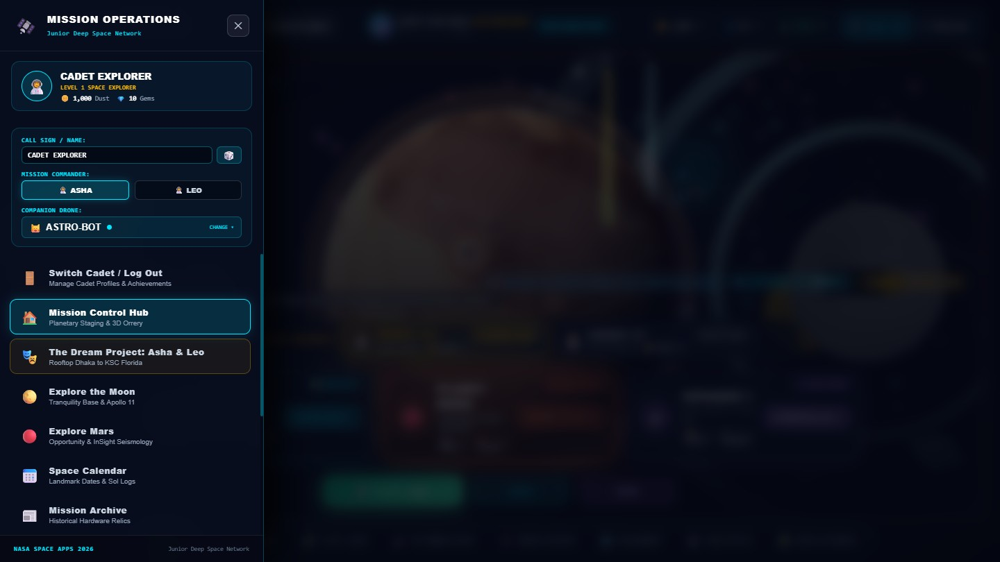

*Figure 7 — The Menu drawer: call sign, commander, companion, quick links to the Prologue, JPL Labs, Roadmap, Quiz and more.*

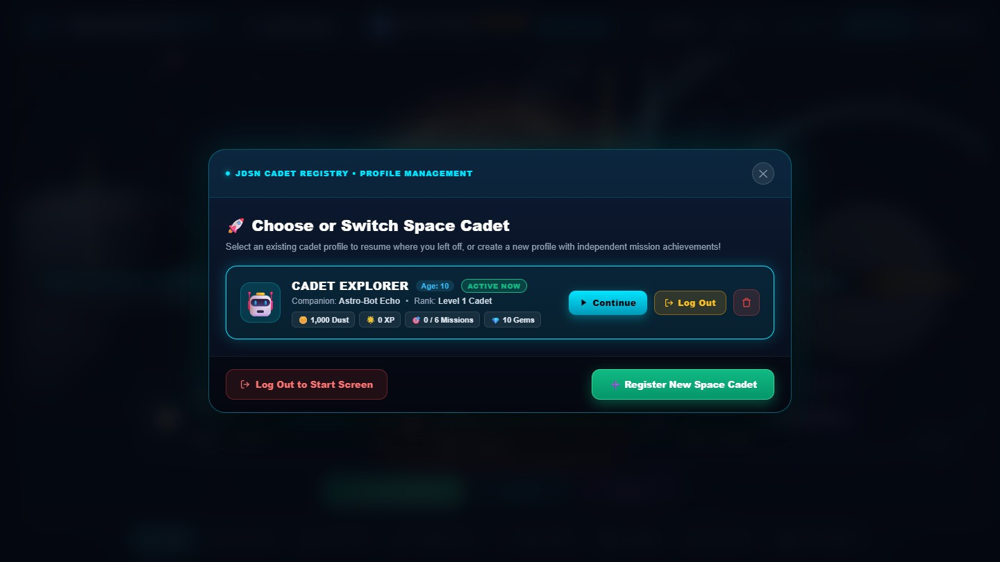

*Figure 8 — The Cadet Registry. Several children can share a device; each profile has its own Dust, Gems, XP and mission progress, and **Log Out** returns to a fresh Start screen.*

#### Step 3 — Explore the Moon

Pressing **Enter Base** places the child directly in a lunar rover on the surface — no pop-ups, no waiting. A glowing beacon marks the first relic, the HUD shows the distance, and the companion bot gives a one-sentence hint.

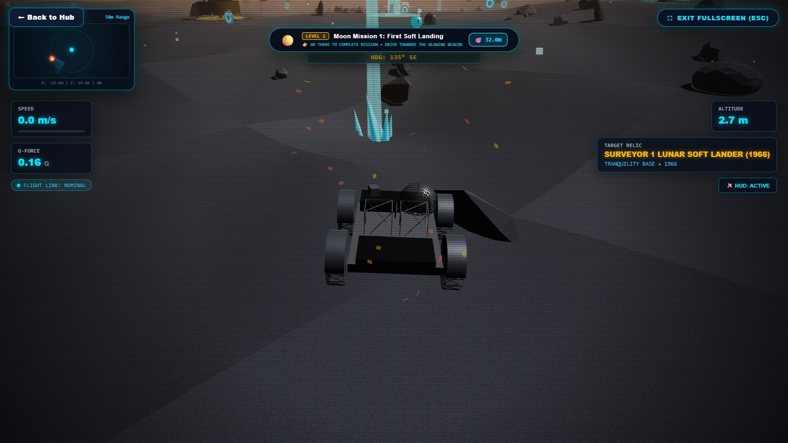

*Figure 9 — The lunar rover at the start of Moon Mission 1. The top bar shows the mission, the distance to the target (32 m) and the objective; the right panel names the target relic.*


*Figure 10 — The child drives with **W / A / S / D** (or on-screen touch controls). The mini-radar on the left tracks the beacon.*

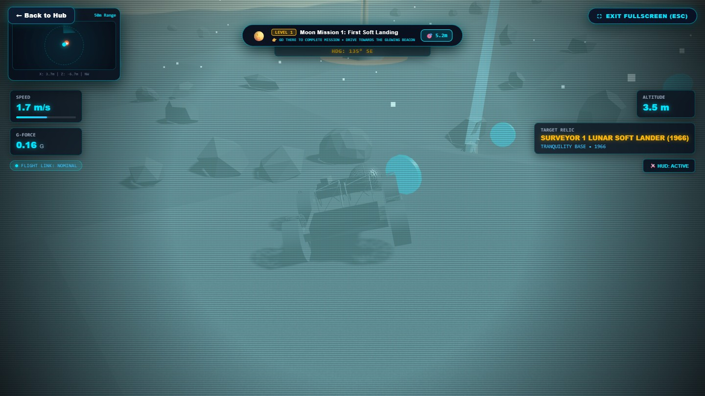

*Figure 11 — Within about 4.5 m of the relic the game *offers* a scan. Nothing happens until the child presses **E** or taps the scan button.*


*Figure 12 — The discovery card: what was found, a child-friendly explanation, and the rewards earned. The child then chooses **Explore More Missions** or **Go to Homepage**.*

#### Step 4 — Explore Mars

On Mars the rover starts 32 m from the first relic, the **Opportunity (MER-B)** rover, in Perseverance Valley. The same drive → scan → discover loop applies, now with the real story of a rover built for 90 days that worked for more than fourteen years.

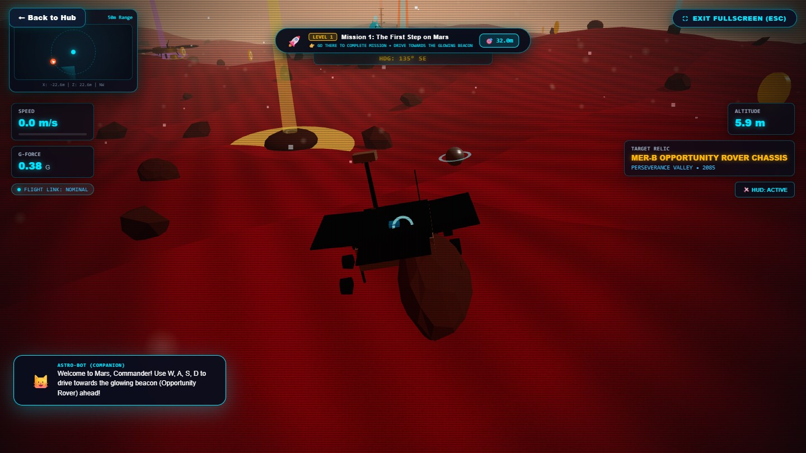

*Figure 13 — Mars Mission 1: "The First Step on Mars". The companion bot explains the controls.*


*Figure 14 — Driving across the Martian terrain toward Opportunity.*

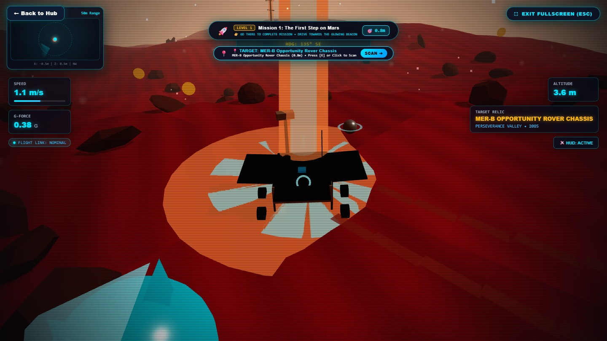

*Figure 15 — Reaching Opportunity. The scan prompt appears only when the child is close enough.*


*Figure 16 — The Mars discovery card with rewards and next-step choices.*

#### Step 5 — Roadmap and levels

Each world has a six-level, winding roadmap. Completed levels glow; the next level is highlighted; the final stop is the Master Certificate.

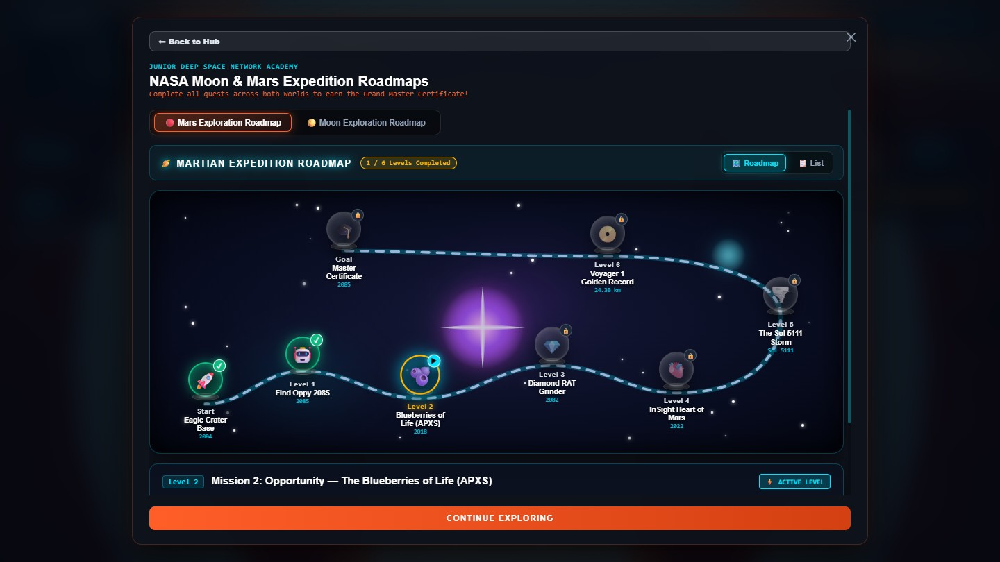

*Figure 17 — The Mars Exploration Roadmap: Eagle Crater Base → Find Oppy → Blueberries of Life (APXS) → Diamond RAT Grinder → InSight Heart of Mars → The Sol 5111 Storm → Voyager 1 Golden Record → Master Certificate. A second tab shows the Moon roadmap.*

#### Step 6 — Deep Space with Voyager 1

In deep space there is no ground, so the game becomes an inspection scene. The child rotates Voyager 1 with **W / A / S / D** and inspects its parts — high-gain dish, RTG power source, Golden Record — while the HUD reminds them that a radio message takes **22 hours 34 minutes** to arrive.

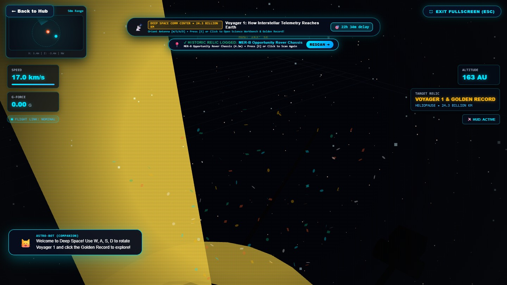

*Figure 18 — Voyager 1 at 24.3 billion km. The Science Lab is opened *only* when the child chooses to.*

#### Step 7 — Four hands-on science labs

Each lab turns one real piece of science into a small puzzle with a commander giving context.

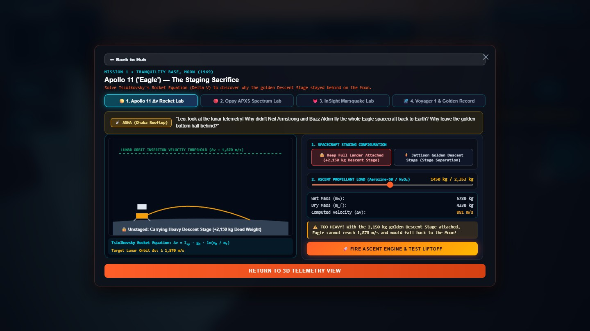

*Figure 19 — Lab 1: **Apollo 11 Δv Rocket Lab**. Why did the astronauts leave the heavy descent stage on the Moon?*

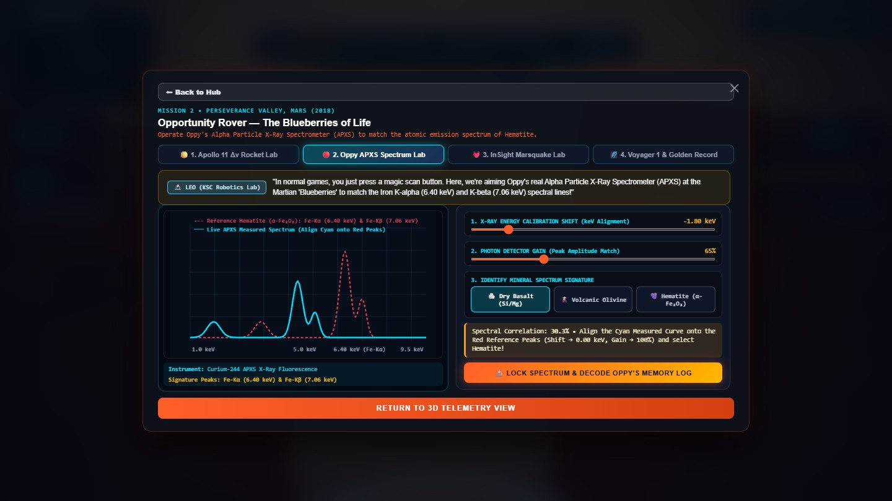

*Figure 20 — Lab 2: **Oppy APXS Spectrum Lab**. Align X-ray peaks to identify the iron in the "blueberries" that proved Mars once had liquid water.*

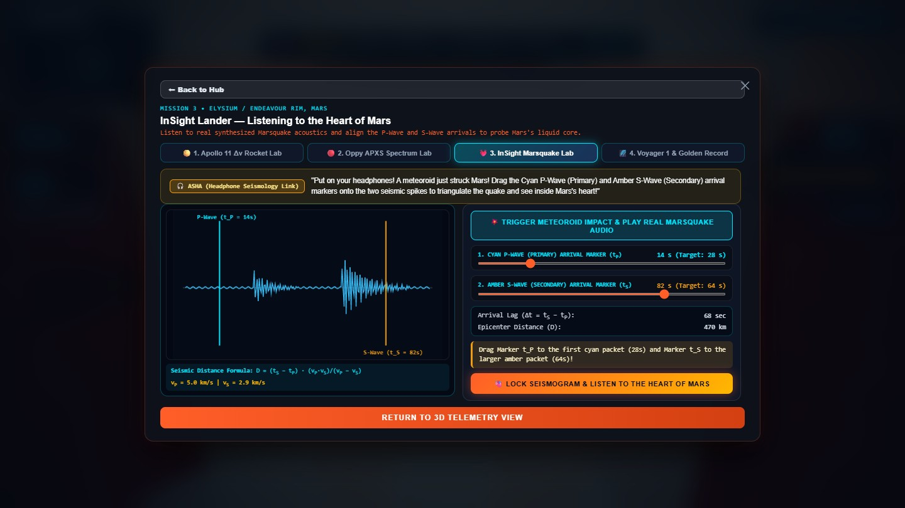

*Figure 21 — Lab 3: **InSight Marsquake Lab**. Match P-waves and S-waves to listen to the heart of Mars.*

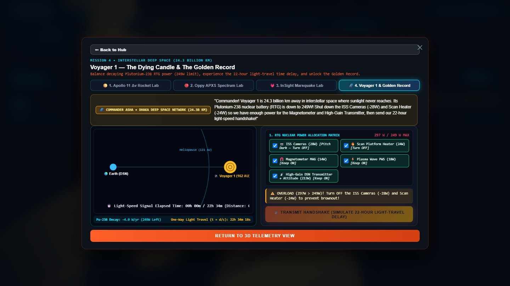

*Figure 22 — Lab 4: **Voyager 1 & Golden Record**. Balance a decaying plutonium power budget, then transmit a handshake across the 22-hour light delay.*

#### Step 8 — Quiz and certificate

After exploring, the child can test their knowledge in the Space Cadet Quiz and compare ranks on the leaderboard. Finishing every mission on a world unlocks the printable Master Certificate.

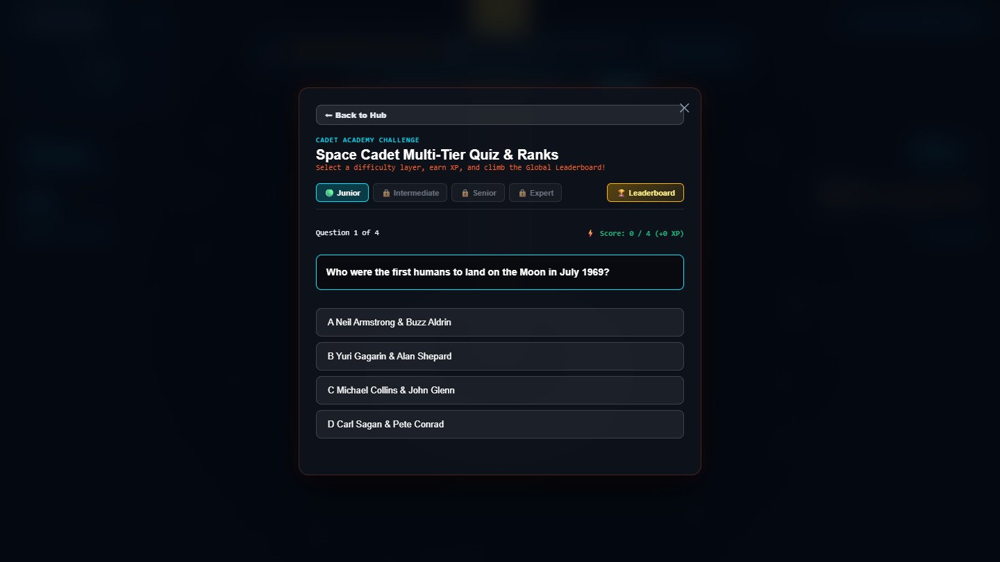

*Figure 23 — The quiz and leaderboard, which reinforce what the child discovered during play.*

### 3.4 The hardware we tell stories about

Every relic in the game is real NASA hardware. Each one is paired with one clear idea a child can carry away.

#### The Moon

| Level | Relic | Year | The story in one sentence |
| :-- | :-- | :-- | :-- |
| 1 | **Surveyor 1** | 1966 | The first U.S. soft landing on the Moon proved the surface was firm, not a sea of dust that would swallow a spacecraft. |
| 2 | **Apollo 11 Lunar Module "Eagle"** | 1969 | The golden descent stage was left behind on purpose to save fuel for the trip home — the rocket equation in action. |
| 3 | **Surveyor 3** | 1969 | Apollo 12 astronauts walked to it and brought parts back: the first off-world archaeology. |
| 4 | **Lunar Roving Vehicle** | 1971 | A battery-powered buggy that drove in one-sixth gravity. |
| 5 | **LCROSS** | 2009 | A mission that confirmed water ice in a permanently shadowed lunar crater. |
| 6 | **Artemis era** | 2026 | The return to the Moon, built on the lessons of the relics above. |

#### Mars

| Level | Relic | Year | The story in one sentence |
| :-- | :-- | :-- | :-- |
| 1 | **Opportunity (MER-B)** | 2004–2018 | Built for 90 sols, it worked for 5,111 — about 57 times longer than planned. |
| 2 | **Hematite "blueberries"** (APXS) | 2004 | Tiny iron-rich spheres showing that liquid water once soaked this ground. |
| 3 | **Rock Abrasion Tool (RAT)** | 2004+ | A diamond grinder that cleaned dust from rock to reveal what lay beneath. |
| 4 | **InSight lander** | 2018–2022 | Its seismometer recorded 1,319 marsquakes and revealed Mars's core. |
| 5 | **Sol 5111 dust storm** | 2018 | A planet-wide storm blocked the sunlight and silenced Opportunity: *"My battery is low and it's getting dark."* |
| 6 | **Voyager 1 & the Golden Record** | 1977– | A gold-plated disc of Earth's sounds, music and greetings in 55 languages, now in interstellar space. |

#### Deep space

| Relic | Story |
| :-- | :-- |
| **Voyager 1** | Launched in 1977, now more than 24 billion km away and still sending data using a plutonium power source that weakens every year. |

### 3.5 Science you can feel — the learning mechanics

The game never asks a child to memorise an equation. It lets them *feel* the idea first, and names it second.

| Idea | Where the child meets it | What they actually do |
| :-- | :-- | :-- |
| **Rocket staging and Δv** | Apollo 11 lab | Decide what to drop to reach orbit with limited fuel. |
| **Spectroscopy** | Opportunity APXS lab | Line up X-ray peaks to identify iron in a rock. |
| **Seismology** | InSight lab | Match P-wave and S-wave arrival times to find a quake's distance. |
| **Power budgets** | Voyager lab | Switch off instruments so the power draw drops below what the RTG can supply. |
| **Light-travel time** | Voyager HUD and lab | See why a message to a probe 24.3 billion km away takes 22 h 34 min. |
| **Dust and sunlight** | Mars Sol 5111 level | See how atmospheric dust reduces solar-panel power. |
| **Low gravity** | Moon HUD | Watch the G-force read-out change between the Moon (0.16 g) and Mars (0.38 g). |

### 3.6 Designing for children — "nothing happens automatically"

During testing we found that children dislike being interrupted. We therefore made a deliberate rule:

> **The game never takes an action *for* the child. It only offers a choice.**

| Moment | What we removed | What the child controls now |
| :-- | :-- | :-- |
| Start of a world | An automatic roadmap pop-up and an automatic radio dialogue. | The rover is simply ready to drive. |
| Reaching a relic | An automatic history pop-up that froze the rover. | A *scan prompt* appears; the child chooses when to scan. |
| Finishing a level | An automatic rocket animation and automatic next-level spawn. | The discovery card offers two clear choices. |
| Returning to the hub | An automatic tour overlay. | The hub is simply shown. |
| Deep space | An automatic science-lab pop-up. | A button in the HUD opens the lab when wanted. |
| Every screen | Dead ends. | A visible **Back to Hub** button on every game screen. |
| Reload | Losing your place. | Progress and the active cadet are restored; logging out returns to a clean Start screen. |

### 3.7 The HOW — architecture and implementation

```
┌──────────────────────── Browser (no install) ────────────────────────┐
│  index.html + style.css  →  Glassmorphism HUD, hub, modals, wizard   │
│                                                                      │
│  src/main.js  (game director)                                        │
│   ├─ renderer/        Three.js scenes: Mars, Moon, deep-space actors │
│   ├─ systems/                                                        │
│   │   ├─ roverControls.js      rocker-bogie rover, W/A/S/D, slope    │
│   │   ├─ scanner.js            raycast + manual scan, relic data     │
│   │   ├─ quests.js             missions, XP, badges, certificate     │
│   │   ├─ minigames.js          the four science labs                 │
│   │   ├─ profileManager.js     multi-cadet profiles in localStorage  │
│   │   ├─ hero3DOrrery.js       hub 3D solar-system background        │
│   │   ├─ audio.js              Web Audio synthesised sound           │
│   │   └─ kittyCompanionManager.js  companion bots and guidance       │
│   └─ data/            relic, mission and telemetry data              │
└──────────────────────────────────────────────────────────────────────┘
```

| Concern | Implementation |
| :-- | :-- |
| **3D rendering** | Three.js (WebGL) with procedurally generated terrain modelled on the character of lunar and Martian surfaces; custom lighting, fog and atmosphere per world. |
| **Rover physics** | Six-wheel rocker-bogie style rover that follows terrain height, tilts on slopes and reports speed, heading, G-force and altitude. |
| **Guidance** | A cyan beacon pillar, a distance read-out, a mini-radar and a companion-bot hint — four independent cues so a child is never lost. |
| **Discovery loop** | Proximity check → scan prompt → child scans → discovery card → rewards and choice. |
| **Progress and profiles** | Each cadet's name, age, bot, Dust, Gems, XP and completed missions are stored in `localStorage` under their own profile; logout clears the active session without deleting profiles. |
| **Audio** | Procedural Web Audio (UI clicks, scanner beeps, thruster puffs, transmission tones) — no audio downloads required. |
| **Localisation** | English and Bengali strings switch instantly across the wizard, HUD, missions and labs. |
| **Hub background** | A live NASA Eyes on the Solar System embed, with an automatic fall-back to our own 3D orrery if the embed is unavailable or offline. |
| **Build and performance** | Vite; single-page; runs at interactive frame rates in a normal laptop browser. |

### 3.8 Testing and quality

- **Automated end-to-end capture.** Every screenshot in this document was captured automatically from the production build with a headless browser that completed the *real* game flow: onboarding → hub → launch Moon → hold **W** until the relic is within scan range → press **E** → discovery card, and the same for Mars, then the roadmap, Voyager and all four labs.
- **Bug-fix pass** carried out before submission: profile and logout persistence, duplicate-profile prevention, hub navigation, a non-working "Enter Mission Control Hub" button, a pop-up that blocked the screen on first launch, and the removal of every automatic interruption listed in [Section 3.6](#36-designing-for-children--nothing-happens-automatically).
- **Production build** compiles cleanly with `npm run build`.

### 3.9 Impact, community and future work

**Who benefits**

- **Students (8–16)** meet real NASA history through play instead of text.
- **Teachers and parents** get a classroom-ready, no-install tool with built-in quiz and certificate.
- **Bengali-speaking learners** get first-class support rather than an afterthought.
- **Siblings and classmates** can share one device with separate profiles.

**A global perspective.** The two mission commanders — **Asha** at a rooftop antenna ground station in Dhaka and **Leo** at a flight-telemetry console near Cape Canaveral — show that space exploration belongs to children everywhere.

**Roadmap**

| Next step | Why |
| :-- | :-- |
| More relics: Viking, Pathfinder/Sojourner, Curiosity, Perseverance/Ingenuity | Broader story across more decades. |
| Chinese, Indian and European relics | Wider international view of discarded hardware. |
| Teacher dashboard (class progress export) | Classroom adoption. |
| More languages | Reach more learners. |
| Narrated audio mode | Further accessibility for early readers. |

---

## 4. Responses to the Challenge Considerations

### What age group is your story designed for?

**School-age children, 8 to 16.** The language is simple, each discovery has a one-sentence takeaway, and the controls are the familiar W/A/S/D. Older students can go deeper in the science labs; younger students can enjoy the driving, rewards and companion bots. Teachers and parents are a secondary audience.

### How accessible is the format you chose to use?

| Barrier | Our answer |
| :-- | :-- |
| Software installation | None — it runs in a web browser. |
| Powerful hardware | Procedural graphics keep downloads small and run on ordinary laptops. |
| Language | Complete English and Bengali switch. |
| Input device | Keyboard (W/A/S/D, E) and on-screen touch controls. |
| Hearing | Every spoken or audio cue also appears as on-screen text. |
| Getting lost | Beacon, distance read-out, radar and bot hint; a **Back to Hub** button on every screen. |
| Shared devices | Multi-cadet profiles with a clean logout. |

### Do you want to focus on specific missions and pieces of equipment, or tell a broader story about NASA's exploration?

**Both.** Each level focuses on one specific machine — Surveyor 1, the Apollo 11 descent stage, Opportunity, InSight, Voyager 1 — and teaches its purpose and discovery in detail. The roadmaps then connect those machines into one arc: *each robot made the next mission possible*.

### What perspective(s) do you want to highlight?

1. **The machines' perspective** — they are explorers with stories, not litter.
2. **The future archaeologist** — in 2085 these sites are heritage monuments.
3. **A global youth perspective** — commanders in Dhaka and Florida, content in English and Bengali.
4. **The scientist's perspective** — every discovery is tied to a real measurement or physical idea.

---

## 5. Tools and Technologies

| Area | Tools |
| :-- | :-- |
| Languages | JavaScript (ES modules), HTML5, CSS3 |
| 3D and graphics | Three.js, WebGL, procedural terrain and shaders |
| Audio | Web Audio API (synthesised) |
| Build | Vite, Node.js |
| Libraries | canvas-confetti (celebrations), marked (document generation), docx (Word export) |
| Embedded NASA tool | NASA Eyes on the Solar System (hub background) |
| Design | Dark "glassmorphism" interface, responsive layout |
| Documentation | Markdown, DOCX and PDF generated by scripts in `scripts/` |
| Testing | Headless Chrome driven over the DevTools protocol to capture the real game flow |

---

## 6. Use of Artificial Intelligence

In line with the Space Apps guidance, we state clearly how AI was used:

- **Coding assistance.** An AI coding assistant helped us write, review and debug parts of the code (for example the profile/logout flow, hub redesign, removal of automatic pop-ups, and the screenshot-capture script).
- **Writing support.** AI helped us draft and polish documentation and check Bengali phrasing.
- **Human responsibility.** The concept (Planetary Archaeology 2085), the story, the choice of relics and facts, the game design, and all final decisions were made by the team. We reviewed and tested every AI-assisted change by running the game.
- **No AI-generated gameplay content at runtime.** The game contains no live generative AI; everything a child sees is authored and fixed.

---

## 7. NASA Data, Resources and Space Agency References

| Source | How it informed the project |
| :-- | :-- |
| **NASA Planetary Data System (PDS)** — MER-B Opportunity | Mission timeline (landing 2004, Sol 5111 in 2018), dust-storm opacity and power figures used in the Mars story and levels. |
| **NASA Mars Reconnaissance Orbiter / HiRISE** | Reference for the character of Perseverance Valley terrain used to shape the procedural Mars surface. |
| **NASA Lunar Reconnaissance Orbiter / LOLA** | Reference for lunar terrain character used to shape the procedural Moon surface. |
| **NASA mission archives** — Surveyor 1 and 3, Apollo 11 and 12, LRV, LCROSS | Historical facts, dates and relic descriptions. |
| **NASA/JPL** — InSight and Voyager | Seismology facts (marsquake count) and Voyager facts (distance, 22 h 34 min light time, RTG decay, Golden Record). |
| **NASA Eyes on the Solar System** | Live 3D solar-system background in the hub. |
| **NASA 3D Resources and JPL hardware references** | Reference for the shapes and proportions of the hardware models. |

Detailed data notes are kept in `docs/project/NASA_DATA_SOURCES.md`.

> Terrain and hardware in the game are *procedural and illustrative*, informed by these sources rather than copied from them. Facts, dates and figures are drawn from NASA public sources.

---

## 8. Team

| Member | Role |
| :-- | :-- |
| **Shaikot Kundu Akash** | Team Lead — project coordination, architecture direction, lead voice-over |
| **Md. Wahiduzzaman Nayem** | System Analyst & Video Editor |
| **Arni Debnath** | Lead Designer — UI/UX, design system, certificate |
| **Tanjir Ahmed Fardin** | Researcher & Storyteller — NASA literature, narrative, dialogue |
| **Tareq Jamil Sarkar Samrat** | Frontend & Core Mechanics Developer — 3D engine, rover, quiz |

---

## 9. How to Run the Project

```bash
# 1. Install dependencies
npm install

# 2. Start the development server (http://localhost:3000)
npm run dev

# 3. Build for production
npm run build
```

**Controls**

| Action | Keyboard | Touch |
| :-- | :-- | :-- |
| Drive rover | W / A / S / D or arrow keys | On-screen steering buttons |
| Scan a relic | E | Scan button |
| Rotate Voyager 1 | W / A / S / D | Drag |
| Back to hub | **Back to Hub** button | **Back to Hub** button |
| Leave full-screen | Esc | Exit button |

---

*Team Relics · 2026 NASA International Space Apps Challenge*
