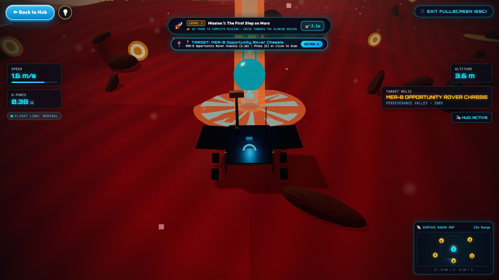
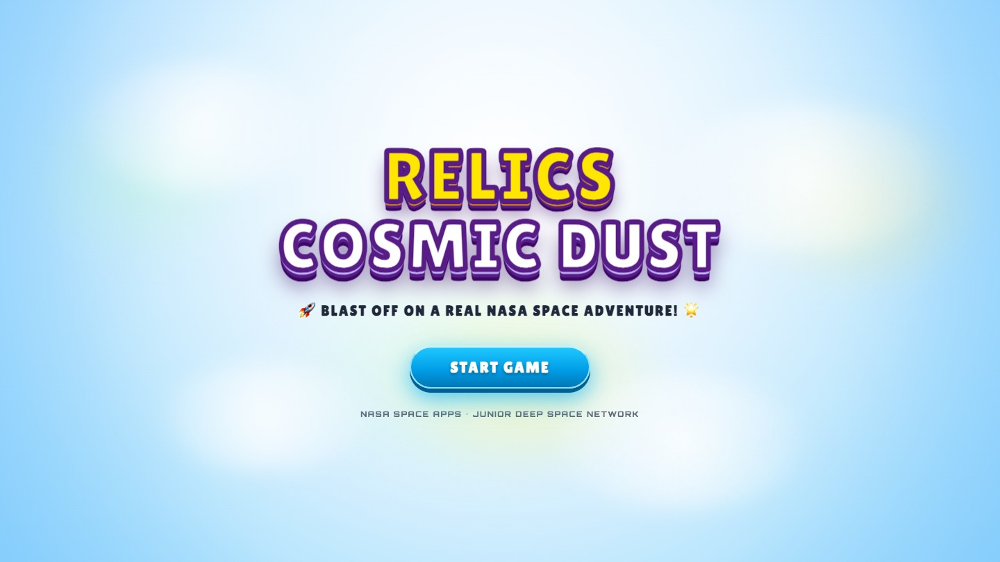
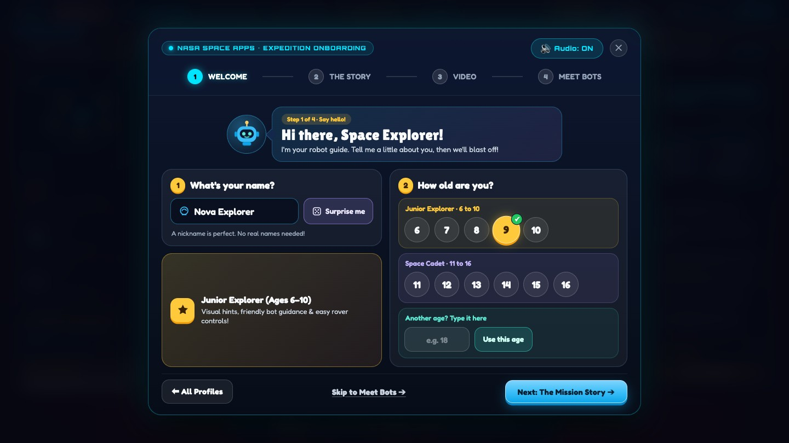
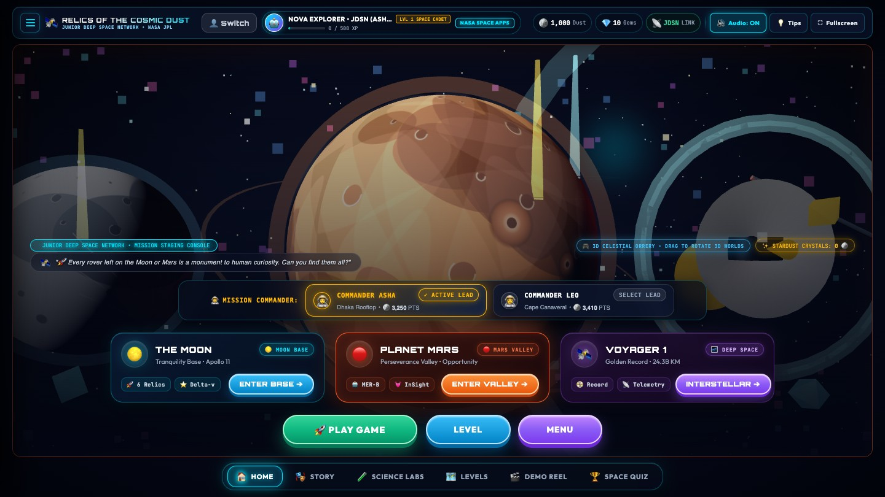
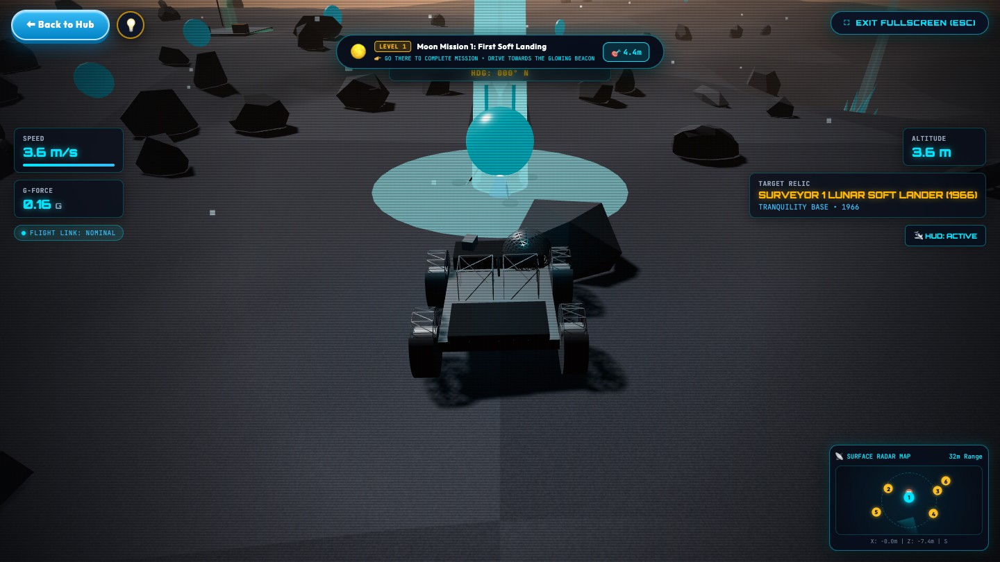
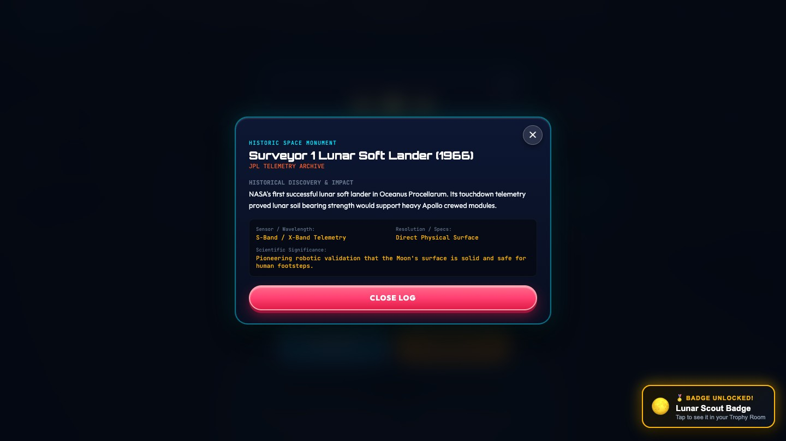
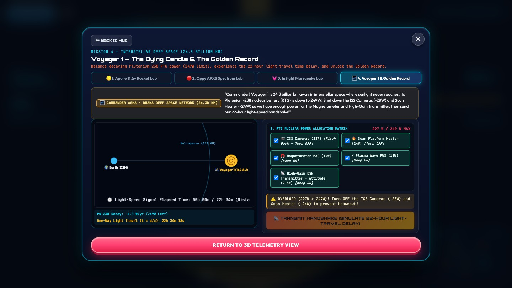
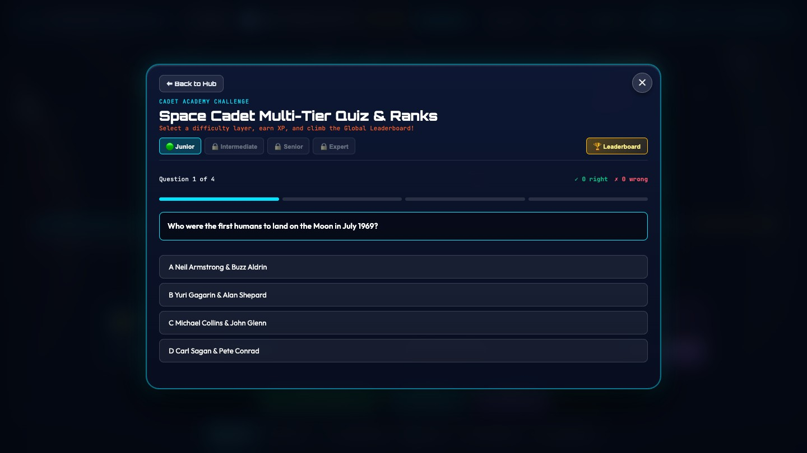

# Relics of the Cosmic Dust

### 240-Second Pitch Video — Script, Shot List and Production Guide

**2026 NASA International Space Apps Challenge · Team Relics**

| | |
| :-- | :-- |
| **Runtime** | 4:00 exactly (240 seconds) |
| **Purpose** | Our "240 Seconds of Glory" pitch for local judging. It works as a video, or as a live presentation with the same structure. |
| **Structure** | Space Apps model: **WHO** (1 min) → **WHY** (1 min) → **WHAT** with a demo (1 min) → **HOW** — impact and needs (1 min) |
| **Format** | 1920 × 1080, 30 fps, H.264 MP4, stereo AAC audio |
| **Voice** | English voice-over by Shaikot, plus short in-scene lines for Emon and Mr. Kabir |
| **Captions** | Burned-in English captions for every spoken line; no other subtitle files |
| **Spoken words** | About 455 words (under 2 words a second), leaving room for music and pauses |
| **Game footage** | Recorded from the current build; every demo shot below can be captured as written |
| **Revision** | Restructured from the original five-block script into the four-quarter pitch. Every scene keeps a reference to the original block, scene and old timeline it came from (Section 5). |

---

## 1. How this script follows "240 Seconds of Glory"

| Quarter | Space Apps asks us to… | How we do it |
| :-- | :-- | :-- |
| **0:00 – 1:00 · WHO** — attention and authenticity | Grab attention in the first 45 seconds. Make the first 15 seconds circular so people lean forward. Say who we are, what makes the team special, win them with a story and show our passion. | Open on Emon's question — *"What happened to them?"* — and only answer it in the last 15 seconds. Then the team, why we are the right people (we were these kids), and a glimpse of us building and testing. |
| **1:00 – 2:00 · WHY** — empathy for the problem | Why it matters, who it affects, why it is an opportunity — with a short story or killer data point, inside 60 seconds. | The archive scene, the class switching off, then one killer story: Opportunity was built for 90 days and worked for 5,111. Who it affects: school students and anyone curious about space, learners put off by expert texts, teachers without labs. |
| **2:00 – 3:00 · WHAT** — the big idea and a demo | How it works, evidence and images, applications, a prototype or demo. | "Planetary Archaeology 2085", then a 35-second live demo of the real game, then how it works and where it can be used. |
| **3:00 – 4:00 · HOW** — impact and our needs | What it will change, what we need to take the next step, and what it could be one day. | Impact, three clear asks (classroom pilots, fact-check mentors, narration), the future vision, and the circular answer to Emon. |

## 2. The story in one paragraph

A 12-year-old student, **Emon**, asks his teacher, **Mr. Kabir**, what happened to the rovers and landers NASA left on the Moon and Mars. The official archives answer the question, but only with long tables, and the class loses interest. Team Relics explains why we built a better answer: **Relics of the Cosmic Dust**, a browser game where children become planetary archaeologists, drive to real relics, scan them and learn their true stories. We close with what we need next — and with Emon's own answer to his question: *they are not space junk, they are monuments.*

## 3. Team roles for this video

| Member | Role in the video |
| :-- | :-- |
| **Shaikot Kundu Akash** | Presenter and lead voice-over, final approval |
| **Md. Wahiduzzaman Nayem** | Editing, motion graphics, captions, sound mix |
| **Arni Debnath** | Title cards, lower thirds, team card, end card, colour grade |
| **Tanjir Ahmed Fardin** | Script accuracy, fact checks, Emon and Mr. Kabir lines |
| **Tareq Jamil Sarkar Samrat** | Records all game footage (Section 7) |

## 4. Pacing at a glance

| Time | Quarter | What the viewer sees | Spoken words |
| :-- | :-- | :-- | :-- |
| 0:00 – 0:15 | WHO · hook | Emon's question, freeze-frame title "What happened to them?" | ~20 |
| 0:15 – 1:00 | WHO · the team | Team card, why us, building and testing the game | ~80 |
| 1:00 – 2:00 | WHY | Archive wall, bored class, Opportunity's story, who it affects | ~130 |
| 2:00 – 3:00 | WHAT | The big idea, 35-second live demo, how it works | ~120 |
| 3:00 – 4:00 | HOW | Impact, our needs, the future, Emon's answer, end card | ~105 |

## 5. New timeline vs. the original script

Each scene below names where it came from in the original five-block script and what changed.

| Scene | New timeline | Original script reference (old timeline) | What changed |
| :-- | :-- | :-- | :-- |
| 1 · The hook | 0:00 – 0:15 | Block 1, Scene 2 (0:10 – 0:30) | The answer is withheld until the end of the video to create a circular hook, instead of moving straight to the solution. |
| 2 · Who we are | 0:15 – 0:40 | Block 1, Scene 1 (0:00 – 0:10) | The quick 10-second team reveal becomes a 25-second personal background story that builds empathy. |
| 3 · Our passion | 0:40 – 1:00 | New — replaces Block 3 (1:00 – 1:30) | The technical GDAL/WebGL and atmospheric tau data-pipeline explanation is replaced with a user-centred behind-the-scenes montage. |
| 4 · The data wall | 1:00 – 1:20 | Block 2, Scenes 3 – 7 (0:30 – 1:00) | Same visuals, shifted 30 seconds later and condensed. |
| 5 · One killer story | 1:20 – 1:40 | Block 4, Scene 19 (2:55 – 3:30), the Sol 5111 storm | Moved from a gamified quiz feature into the emotional core of WHY. |
| 6 · Who it affects | 1:40 – 2:00 | New — replaces Block 3 physics | The Three.js and Beer-Lambert Law explanations are replaced with a clear impact case: who it is for. |
| 7 · The big idea | 2:00 – 2:10 | Block 4, Scenes 11 – 12 (1:30 – 1:55) | The platform reveal is shortened from 25 seconds to 10. |
| 8 · Live demo | 2:10 – 2:45 | Block 4, Scenes 13 – 19 (1:55 – 3:30) | A 95-second sequence shrinks to 35 seconds; the LIDAR scan audio dialogue is dropped; the Voyager 1 deep-space lab is new. |
| 9 · How it works | 2:45 – 3:00 | Block 4, Scene 12 (1:44 – 1:55) | Recycles the zero-install WebGL value proposition. |
| 10 · What it will change | 3:00 – 3:20 | Block 5, Scene 20 (3:30 – 4:00) | Re-uses the classroom celebration and Master Planetary Archaeologist certificate, and adds home use. |
| 11 · What we need next | 3:20 – 3:40 | New — replaces Block 5, Scene 20 call-to-action | Three explicit asks replace the global call-to-action pointing to the open-source pipeline and GitHub URL. |
| 12 · What it could be & Emon's answer | 3:40 – 4:00 | Block 5, Scene 20 (3:32 – 4:00) | Mr. Kabir's closing remark and the Team Lead's outro voice-over are replaced by Emon's circular answer. |

---

## 6. Scene-by-scene script

### Quarter 1 — WHO: attention and authenticity (0:00 – 1:00)

#### Scene 1 · 0:00 – 0:15 · The hook

| Element | Detail |
| :-- | :-- |
| **Visual** | Close-up of Emon, 12, raising his hand in a bright classroom. Mr. Kabir turns. At 0:10 the frame freezes and a title punches in. |
| **Emon** | "Sir, NASA sent so many rovers and landers to the Moon and Mars. What happened to them?" |
| **Mr. Kabir** | "That… is a very good question." |
| **On screen** (0:10 – 0:15) | **What happened to them?** |
| **Audio** | Classroom hush, one chair creak, a single low synth note under the freeze-frame. |
| **Original script reference** | Adapts Block 1, Scene 2 (old timeline 0:10 – 0:30), where Emon originally asked the question. |
| **Change** | The answer is now intentionally withheld until the end of the video to create a circular hook, rather than immediately moving to the solution. |

*Circular hook: this question is answered only in Scene 12.*

#### Scene 2 · 0:15 – 0:40 · Who we are

| Element | Detail |
| :-- | :-- |
| **Visual** | Glass-style team card with five photos and names. Cut to Shaikot on camera (or over the team card). |
| **On screen** | **TEAM RELICS** · Shaikot Kundu Akash — Team Lead · Md. Wahiduzzaman Nayem — System Analyst & Video Editor · Arni Debnath — Lead Designer · Tanjir Ahmed Fardin — Researcher & Storyteller · Tareq Jamil Sarkar Samrat — Frontend & Core Mechanics |
| **Voice-over** | "We are Team Relics — five students from Bangladesh. A few years ago, we were Emon. We loved space, but almost every space story we found was buried in long pages, full of hard words, and written for experts. So we built the game we wished we'd had." |
| **Audio** | A warm synth pulse begins. |
| **Original script reference** | Modifies Block 1, Scene 1 (old timeline 0:00 – 0:10). |
| **Change** | The quick 10-second UI team reveal is expanded into a 25-second personal background story to build empathy for the pitch format. |

#### Scene 3 · 0:40 – 1:00 · Our passion

| Element | Detail |
| :-- | :-- |
| **Visual** | Fast, real behind-the-scenes montage: sketches of the hub, a laptop with code, Arni designing the age bubbles, Samrat driving the rover, a child playing while the team watches. Use only real footage from your own build and testing; drop any shot you don't have. |
| **Voice-over** | "We researched NASA's mission records, designed it so a young student and a grown-up space fan can both enjoy it, and tested with children — then rebuilt the game around what they told us: don't interrupt me, and let me choose." |
| **Audio** | Music lifts; keyboard taps and a laugh under the montage. |
| **Original script reference** | Completely new sequence for the pitch. |
| **Change** | Replaces the highly technical GDAL/WebGL and atmospheric tau data-pipeline explanations from Block 3 (old timeline 1:00 – 1:30) to focus on user-centred design. |

### Quarter 2 — WHY: create empathy for the problem (1:00 – 2:00)

#### Scene 4 · 1:00 – 1:20 · The data wall

| Element | Detail |
| :-- | :-- |
| **Visual** | Back in the classroom: Mr. Kabir types "NASA" and the front screen fills with long archive pages and data tables. Slow pan across the desks: one student rests his head on his arms, another doodles. |
| **Mr. Kabir** (muttering) | "So many tables… where is the story?" |
| **Voice-over** | "For sixty years NASA has left machines on the Moon and Mars. Their stories are true and amazing — but locked inside dense archives, they start to sound like space junk, and children switch off." |
| **Audio** | Keyboard clicks, mouse scrolling, a clock ticking, a yawn. |
| **Original script reference** | Directly imports Block 2, Scenes 3 – 7 (old timeline 0:30 – 1:00) with identical visuals. |
| **Change** | The sequence is shifted 30 seconds later in the timeline and condensed. |

#### Scene 5 · 1:20 – 1:40 · One killer story

| Element | Detail |
| :-- | :-- |
| **Visual** | Mars in the game: Opportunity on the slope (Figure 1). Big numbers animate in one by one. The sky darkens. |
| **On screen** | **Built for 90 days** · **Worked for 5,111 sols** · *"My battery is low and it's getting dark."* |
| **Voice-over** | "Take Opportunity. It was built to last ninety days on Mars. It kept driving for more than fourteen years, until a dust storm blocked out the Sun. That's one of the greatest stories in science — and in an archive, it's a row in a table." |
| **Audio** | Martian wind; music drops to a single slow phrase. |
| **Original script reference** | Pulls from the gamification sequence in Block 4, Scene 19 (old timeline 2:55 – 3:30), which featured the Sol 5111 storm. |
| **Change** | Repositioned from a gamified quiz feature into the emotional core of the WHY segment. |

_Figure 1 — Scene 5: the rover reaching Opportunity in the game._

#### Scene 6 · 1:40 – 2:00 · Who it affects, and the opportunity

| Element | Detail |
| :-- | :-- |
| **Visual** | Three simple icon cards slide in, then fold into one glowing word: **Opportunity**. |
| **On screen** | School students and anyone curious about space · Learners put off by expert texts · Teachers without labs or powerful computers |
| **Voice-over** | "This affects school students, curious learners of any age who give up on long expert texts, and teachers without labs or powerful computers. But it is also an opportunity: these machines are already there, their stories are already true — they just need a way in." |
| **Audio** | Music begins to build. |
| **Original script reference** | Entirely new addition. |
| **Change** | Replaces the Three.js and Beer-Lambert Law physics explanations from Block 3 to establish a clear business and impact case. |

### Quarter 3 — WHAT: our big idea and a demo (2:00 – 3:00)

#### Scene 7 · 2:00 – 2:10 · The big idea

| Element | Detail |
| :-- | :-- |
| **Visual** | Emon walks to the front, opens a link, and the Start screen appears on the classroom screen (Figure 2). Title card: "Planetary Archaeology 2085". |
| **Voice-over** | "Our idea: it's the year 2085, the landing sites are heritage monuments, and you are a young planetary archaeologist." |
| **Audio** | Orchestral swell, sparkle on the Start button. |
| **Original script reference** | Adapts Block 4, Scenes 11 – 12 (old timeline 1:30 – 1:55). |
| **Change** | Shortens the platform reveal from 25 seconds down to 10 seconds. |

_Figure 2 — Scene 7: the Start screen._

#### Scene 8 · 2:10 – 2:45 · Live demo

Real game footage, full screen, cut to the beat, with two quick cut-aways to students reacting.

| Time | Shot | On screen |
| :-- | :-- | :-- |
| 2:10 – 2:14 | Welcome card: name, "Surprise me", age bubble (Figure 3) | Your name · Your age |
| 2:14 – 2:19 | Hub: hover Moon, Mars, Voyager 1; the 3D background flies to each (Figure 4) | Three worlds |
| 2:19 – 2:26 | Moon: drive to the beacon, radar map tracking the dot (Figure 5) | Drive with W A S D |
| 2:26 – 2:33 | Scan prompt beside Surveyor 1, press **E**, relic log opens (Figure 6) | Surveyor 1 · 1966 |
| 2:33 – 2:39 | Voyager 1 turning in deep space, then the Voyager power lab (Figure 7) | 22 h 34 min light delay |
| 2:39 – 2:45 | Space Quiz: correct answer, confetti (Figure 8) | Quiz · badges · certificate |

| Element | Detail |
| :-- | :-- |
| **Students** | "Whoa!" · "Go left — toward the light!" |
| **Voice-over** | "A robot guide welcomes you. You pick a world, drive your rover to a real relic, and choose when to scan it. Then you learn its true story — Surveyor 1 proved the Moon was firm enough to land on. Fly out to Voyager 1, balance its fading nuclear power in a science lab, and test yourself in a quiz." |
| **Audio** | Rover motor, scan sweep on **E**, transmission beeps, quiz chime and confetti pop — all under the music. |
| **Original script reference** | Condenses the entire interactive simulation from Block 4, Scenes 13 – 19 (old timeline 1:55 – 3:30). |
| **Change** | Shrinks a 95-second sequence to 35 seconds, drops the LIDAR scan audio dialogue, and introduces the entirely new Voyager 1 deep-space lab segment. |

_Figure 3 — Scene 8, 2:10: the Welcome card._

_Figure 4 — Scene 8, 2:14: hovering Planet Mars on the hub._

_Figure 5 — Scene 8, 2:19: driving toward the beacon._

_Figure 6 — Scene 8, 2:26: the relic log after pressing E (record the Surveyor 1 log; see Section 7)._

_Figure 7 — Scene 8, 2:33: the Voyager 1 power lab._

_Figure 8 — Scene 8, 2:39: the Space Cadet Quiz._

#### Scene 9 · 2:45 – 3:00 · How it works

| Element | Detail |
| :-- | :-- |
| **Visual** | Clean motion graphic: a browser window with three labelled layers stacking up, then three small "where it's used" icons. |
| **On screen** | Facts from NASA mission records · Worlds shaped by NASA orbiter maps · Runs in any browser, no install · Classrooms · Homes · Science clubs |
| **Voice-over** | "Every relic, date and number comes from NASA's public mission records. It runs in any browser with nothing to install — in classrooms, at home or in science clubs." |
| **Audio** | Soft "data" sweep as each layer lands. |
| **Original script reference** | Recycles the key technical value proposition from Block 4, Scene 12 (old timeline 1:44 – 1:55) about zero-install WebGL. |
| **Change** | Kept as the closing beat of WHAT: runs in any browser, no install. |

### Quarter 4 — HOW: impact and our needs (3:00 – 4:00)

#### Scene 10 · 3:00 – 3:20 · What it will change

| Element | Detail |
| :-- | :-- |
| **Visual** | Students in the classroom leaning in, arguing over the radar map; a child at home playing with a younger sibling; the certificate on screen. |
| **Voice-over** | "Children stop memorising dates and start discovering. Students without powerful computers finally get a real space game in their browser. Teachers get a ready-made lesson with a quiz and a certificate — on the computers they already have." |
| **Audio** | Music warm and steady. |
| **Original script reference** | Re-uses elements from Block 5, Scene 20 (old timeline 3:30 – 4:00): the classroom celebration and the Master Planetary Archaeologist certificate. |
| **Change** | Expands the visual context to include home use rather than just the classroom. |

#### Scene 11 · 3:20 – 3:40 · What we need next

| Element | Detail |
| :-- | :-- |
| **Visual** | Shaikot on camera, or three bold numbered cards. |
| **On screen** | **1** Schools to pilot it in real classrooms · **2** Mentors to review our space-history facts · **3** Voices to narrate it for early readers |
| **Voice-over** | "To take the next step, we need three things: schools willing to pilot it in real classrooms, mentors to review our facts, and voices to narrate it for children who are still learning to read." |
| **Audio** | Music pulls back so the asks are clear. |
| **Original script reference** | New explicit pitch requirements. |
| **Change** | Completely replaces the original Block 5, Scene 20 global call-to-action that pointed to the open-source pipeline and GitHub URL. |

#### Scene 12 · 3:40 – 4:00 · What it could be — and Emon's answer

| Element | Detail |
| :-- | :-- |
| **Visual** | Montage: the Moon, Mars and Voyager 1 from the game, then the classroom. Emon stands at the front beside the screen. The end card fades in at 3:52. |
| **Voice-over** | "One day, every machine humanity has left in space — from every space agency, in every child's language." |
| **Mr. Kabir** | "So, Emon — what happened to them?" |
| **Emon** | "They're not space junk, sir. They're monuments!" |
| **On screen** (3:52 – 4:00) | **RELICS OF THE COSMIC DUST** · *Abandoned, but not forgotten.* · Team Relics · Play in your browser: [live link] · NASA International Space Apps Challenge 2026 |
| **Audio** | Full, warm finale; classroom applause fades under the final chord. |
| **Original script reference** | Alters Block 5, Scene 20 (old timeline 3:32 – 4:00). |
| **Change** | Replaces Mr. Kabir's closing remark and the Team Lead's outro voice-over with a circular storytelling resolution directly involving the student. |

---

## 7. Recording the game footage

Record every game shot from the current build, at the same size as the final video.

| Setting | Value |
| :-- | :-- |
| Browser window | Chrome, 1920 × 1080 content area (use full screen, F11) |
| Recorder | OBS Studio, 1920 × 1080, 30 fps, high-quality MP4 |
| Cursor | Visible only for the hub hovers; hidden elsewhere |
| Sound | Record game audio on a separate track so the editor can lower it under the voice |
| Fresh start | Before each take: Menu → Switch Cadet / Log Out → Log Out to Start Screen, then register a new cadet, so the Moon and Mars start at Mission 1 |
| Tips | Press **Don't show tips again** on the first tip, unless you are recording the tips themselves |

| Scene | What to do in the game |
| :-- | :-- |
| 5 | Start Mars (**Enter Valley**) and drive up to Opportunity; record the approach for 8 seconds. |
| 7 | Open the game and wait on the Start screen for 3 seconds, then press **Start Game**. |
| 8 · 2:10 | On the Welcome card, type a name, press **Surprise me** once, tap an age. |
| 8 · 2:14 | On the hub, slowly hover The Moon, Planet Mars and Voyager 1, holding each for 2 seconds. |
| 8 · 2:19 | **Enter Base** (Moon). Drive toward the beacon with W/A/S/D, keeping it in the centre. |
| 8 · 2:26 | Stop when the scan prompt names **Surveyor 1** — other relics nearby can also trigger a prompt. Wait 1 second, press **E**, hold on the relic log for 6 seconds. |
| 8 · 2:33 | Back to Hub → **Interstellar**; hold D for 2 seconds. Then **Science Labs** → tab 4, switch off two instruments until the power fits, press **Transmit**. |
| 8 · 2:39 | **Space Quiz** → answer the first question correctly. |
| 10 | For the certificate, use a profile that has finished every mission on one world (the certificate opens automatically); otherwise use the Badges screen. |

## 8. Edit and delivery checklist

- [ ] Each quarter is exactly one minute: WHO ends at 1:00, WHY at 2:00, WHAT at 3:00.
- [ ] The first 15 seconds end on the question "What happened to them?", and Emon answers it before the end card.
- [ ] Every scene matches its row in Section 5 (new timeline and original script reference).
- [ ] The three asks in Scene 11 are on screen as text, not only spoken.
- [ ] Every spoken line has a burned-in English caption (large, high-contrast, safe-area aware).
- [ ] Voice sits clearly above the music (aim for music about 18 dB under speech).
- [ ] Game footage is sharp at 1080p; no browser bars, bookmarks or notifications visible.
- [ ] Facts match the game and the submission document: Surveyor 1 (1966), Opportunity (built for 90 days, worked 5,111 sols), Voyager 1 (22 h 34 min light delay).
- [ ] Team names and roles are spelled correctly; end card link filled in and readable for at least 5 seconds.
- [ ] Export: H.264 MP4, 1920 × 1080, 30 fps, about 10–16 Mbps, AAC 192 kbps.

---

*Team Relics · 2026 NASA International Space Apps Challenge*
