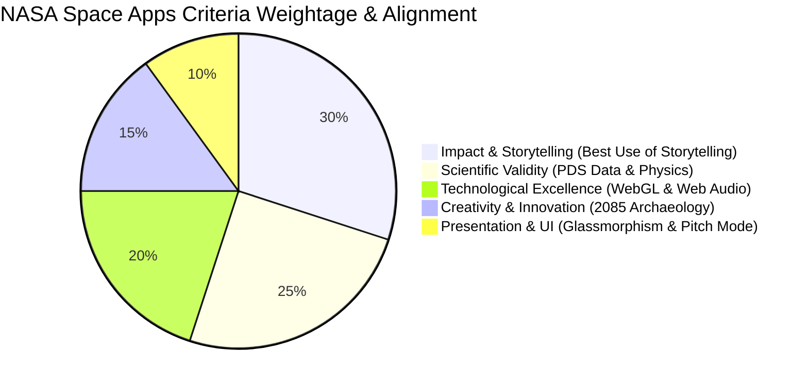

# 🏆 04. NASA SPACE APPS STRATEGY & EVALUATION ALIGNMENT

## 1. Global Judging Criteria Mapping

The NASA Space Apps Challenge evaluates projects based on five core criteria. Here is how **Relics of the Red Dust** satisfies each criterion:



| Judging Criterion | Implementation in Relics of the Red Dust | Scientific / Technical Evidence |
| :--- | :--- | :--- |
| **1. Impact & Storytelling** *(Target: Best Use of Storytelling / Most Inspirational)* | Transforms raw planetary numbers into an emotional narrative of Opportunity's 15-year voyage through the lens of a 2085 Planetary Archaeologist. | Opportunity survived 5,111 sols (over 57x its design life), proving Mars was once habitable and wet before succumbing to the Sol 5111 storm. |
| **2. Scientific Validity** *(Best Use of Data)* | Accurate mathematical implementation of the **Beer-Lambert Law** ($P \propto e^{-\tau}$), authentic PDS atmospheric optical depth logs, and exact spectral instruments. | Validated against Opportunity MER-B PDS Archive (June 2018 Tau=10.8, power collapse to 22 Wh/sol, 20.5V battery cutoff). |
| **3. Technological Excellence** *(Art & Technology)* | Custom client-side Three.js procedural DEM terrain engine, real-time atmospheric scattering shaders, LiDAR raycasting, and Web Audio synthesizer. | Zero external heavy asset dependencies; instant 60 FPS performance in browser with responsive mobile touch controls. |
| **4. Creativity & Innovation** | "Planetary Archaeology": reframing abandoned space hardware not as space junk, but as historic human heritage monuments. | Interactive S-Curve Celestial Roadmap gamifying scientific discovery across 6 milestone levels. |
| **5. Presentation & Polish** | AAA-grade dark space glassmorphic Game Hub, bilingual English/Bengali localization, and an automated 120-second cinematic pitch showcase. | One-click 2-minute pitch director guiding judges through all project highlights with synchronized subtitles. |

---

## 2. Scientific Data & PDS Ground Truth

### 2.1 The Sol 5111 Planetary Storm Event
- **Date**: June 10, 2018 (Sol 5111)
- **Location**: Perseverance Valley, Rim of Endeavour Crater, Meridiani Planum ($2.21^\circ\text{S}, 354.67^\circ\text{E}$).
- **Atmospheric Optical Depth ($\tau$)**: Peak measured at **10.8** (Highest atmospheric dust opacity ever recorded on Mars).
- **Sunlight Extinction**: $1 - e^{-10.8} = 99.998\%$ of solar photons blocked.
- **Power Production**: Nominally $\sim 900\text{ Wh/sol} \to 22\text{ Wh/sol}$.
- **Final Command Sequence**: Spacecraft attempted emergency sleep recovery, but bus voltage dropped below 20.5V, entering permanent clock fault state.

### 2.2 Geological Relics & In-Game Verification
1. **Hematite Spherules ("Martian Blueberries")**: Discovered at Eagle Crater; spherical concretion precipitated inside liquid acidic groundwater lakes billions of years ago.
2. **Jarosite Mineral (Verified via Mössbauer Spectrometer)**: Hydrated iron sulfate mineral that only forms in the presence of liquid water.
3. **Circular Grind Holes (Rock Abrasion Tool - RAT)**: Diamond grinder stripped away weathered dust patina, revealing pristine unoxidized inner rock matrix.

---

## 3. 120-Second Pitch Showcase Director Breakdown

The integrated automated showcase director (`src/systems/pitchMode.js`) leads evaluators through a synchronized 4-act cinematic journey:

```
[00:00 - 00:18] ACT I: THE PROMISE OF SOL 1
Camera zooms on Opportunity standing under clear Martian skies (Tau = 0.8, 900 Wh).
Narrator: "In 2004, Opportunity landed on Mars for a 90-sol mission. It endured for 15 years, discovering ancient water."

[00:19 - 00:55] ACT II: THE FATEFUL SOL 5111 STORM
Atmospheric Tau dynamically slides to 10.8; sky turns apocalyptic black; power graph drops to 22 Wh.
Narrator: "Then, on Sol 5111, an unprecedented global dust storm stole its light. 'My battery is low and it's getting dark.'"

[00:56 - 00:88] ACT III: ARCHAEOLOGICAL REDISCOVERY (2085)
LiDAR scanner activates; reticle rings illuminate the rover, Mössbauer, RAT, and blueberries.
Narrator: "In 2085, humanity returns. Using LiDAR telemetry and PDS records, we decode Opportunity's final memory core."

[00:89 - 02:00] ACT IV: THE ETERNAL LEGACY
Camera orbits into panoramic starry vista; celebratory fanfare and certification unlock.
Narrator: "Oppy did not die alone. It showed us that Mars was once alive. We preserve its legacy as planetary heritage."
```

---

## 4. Youth Education & Gamification Mechanics

- **Milestone S-Curve Roadmap**: Encourages sequential progression through hands-on scientific tasks.
- **Interactive Space Cadet Quiz**: Tests knowledge retention on Martian dust, sol duration, and water discoveries.
- **Master Explorer Certificate**: High-resolution print-ready certificate of honor awarded upon 100% mission completion.
- **Bilingual Accessibility**: Full English and Bengali interface empowers students across South Asia and global communities.
