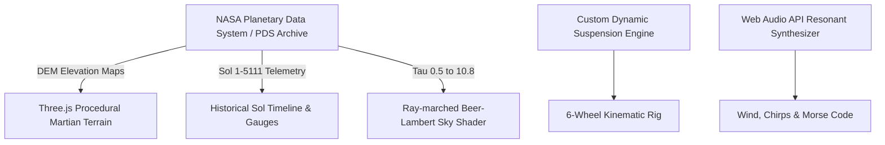

# 🎬 06. OFFICIAL PRODUCTION BLUEPRINT & 240-SECOND VIDEO SCRIPT

## NASA SPACE APPS CHALLENGE 2026
**Project Name**: Relics of the Red Dust (রিলিক্স অব দ্য রেড ডাস্ট: ইয়ুথ এক্সপ্লোরার)  
**Challenge Selected**: Abandoned but Not Forgotten: Storytelling about NASA's Discarded Equipment on the Moon and Mars  
**Global Theme**: The Next Frontier (2026)  
**Project Scope & Target**: Beginner / Youth & Intermediate — Interactive 3D Web & STEM Storytelling Platform  
**Subjects**: Astrophysics, Planetary Science, Space Exploration  

---

## 1. Team Members & Production Roles

| Member Name | Assigned Role | Primary Responsibilities |
| :--- | :--- | :--- |
| **Shaikot Kundu Akash** | **Team Lead** | Overall project coordination, system architecture direction, team sync, and lead presenter. |
| **Nayem Wahid** | **System Architect & Video Editor** | Core web architecture, audio-visual editing, motion graphics design, and video production pipeline. |
| **Arni Debnath** | **Lead Designer** | UI/UX wireframes, glassmorphism HUD design, graphic assets, typography, and certificate visuals. |
| **Tanjir Ahmed Fardin** | **Researcher & Storyteller** | Scientific literature review, narrative scriptwriting, PDS data curation, and bilingual dialogue design. |
| **Tareq Jamil Sarkar Samrat** | **Frontend & Core Mechanics Developer** | Three.js 3D physics engine, rover controls, Sol 5111 simulation shaders, and quest gamification engine. |

---

## 2. 240-Second Video Script & Production Timeline (4 Minutes)

### ■ 0:00 – 0:30 | Act I: Introduction & Team (30 Seconds)
- **Core Focus**: Establish team identity, member roles, and chosen NASA challenge.
- **Visuals & Screen Action**:
  - `0:00–0:10`: High-energy opening title sequence with cinematic Martian topography, project title *'Relics of the Red Dust'*, and the NASA Space Apps 2026 *'The Next Frontier'* logo overlay.
  - `0:10–0:30`: Crisp dynamic grid showcasing all five team members with animated lower-third title cards highlighting each member's name and dedicated role:
    - Shaikot Kundu Akash (Team Lead)
    - Nayem Wahid (System Architect & Video Editor)
    - Arni Debnath (Designer)
    - Tanjir Ahmed Fardin (Researcher & Storyteller)
    - Tareq Jamil Sarkar Samrat (Frontend & Core Mechanics Developer).
- **Spoken Voiceover (Exact VO)**:
  > *"Hello NASA Space Apps! We are Team Relics of the Red Dust. I am Shaikot Kundu Akash, Team Lead. Joining me are Nayem Wahid, our System Architect and Video Editor; Arni Debnath, our Lead Designer; Tanjir Ahmed Fardin, Researcher and Storyteller; and Tareq Jamil Sarkar Samrat, Frontend and Core Mechanics Developer. Under the 2026 theme 'The Next Frontier', we tackled the challenge: Abandoned but Not Forgotten: Storytelling about NASA's Discarded Equipment on the Moon and Mars."*
- **Director & Audio Notes**: Camera starts wide and pushes in on each member portrait during callouts. Keep music upbeat, futuristic synth at -18dB under VO.

---

### ■ 0:30 – 1:00 | Act II: The Problem (30 Seconds)
- **Core Focus**: Identify the disconnect between decommissioned NASA hardware and public/student accessibility.
- **Visuals & Screen Action**:
  - `0:30–0:45`: Dramatic slow-panning 3D shot of the Opportunity (MER-B) rover resting motionless in Perseverance Valley / Endeavour Crater, enveloped in reddish haze and dust accumulation.
  - `0:45–1:00`: Fast split-screen montage contrasting dense, inaccessible raw telemetry tables and academic PDF papers against uninspired students struggling with conventional space education materials.
- **Spoken Voiceover (Exact VO)**:
  > *"Since the 1960s, NASA has deployed historic rovers and landers across extraterrestrial terrains. Though their operational lifespans end, they remain humanity's greatest archaeological monuments in deep space. For instance, the Opportunity rover traversed over 45 kilometers on Mars before succumbing to a catastrophic global dust storm. Tragically, these historic voyages and scientific breakthroughs remain buried within complex technical archives—far out of reach for students and young minds. How do we resurrect these dormant relics to educate and inspire the next generation of space pioneers?"*
- **Director & Audio Notes**: Tone shifts to contemplative and solemn. Wind sound effects mixed lightly into the background with resonant bandpass filtering.

---

### ■ 1:00 – 1:30 | Act III: Data Sources & Scientific Pipeline (30 Seconds)
- **Core Focus**: Transparently validate NASA open data integration and technical ingestion pipeline.
- **Visuals & Screen Action**:
  - `1:00–1:15`: Screen recording of accessing NASA Planetary Data System (PDS) archives, downloading HiRISE Digital Elevation Models (DEMs), and Opportunity's Sol 1 to Sol 5111 mission logs.
  - `1:15–1:30`: Fast animated diagram showcasing data flow: PDS telemetry logs converting into Three.js terrain heightmaps, wheel rotation physics, and real-time atmospheric optical depth (Tau) shader parameters.
- **Spoken Voiceover (Exact VO)**:
  > *"To guarantee rigorous scientific authenticity, our platform directly integrates open data from the NASA Planetary Data System (PDS). We reconstructed authentic Martian surface topography inspired by HiRISE orbital elevation data, incorporated Opportunity's exact 45.16-kilometer historical odometer logs, and mapped recorded atmospheric optical depth—tau—measurements up through the rover's poignant final transmission at Sol 5111."*
- **Director & Audio Notes**: Highlight NASA logos, PDS data URLs, and code snippets on screen to demonstrate rigorous authenticity.

---

### ■ 1:30 – 3:30 | Act IV: The Solution & Live Demo (120 Seconds / 2 Minutes)
- **Core Focus**: Comprehensive walkthrough of prototype functionality, UI/UX, physics, relics, simulation, and certification.
- **Visuals & Screen Action (4 Sub-Segments)**:
  - `1:30–1:55 [Core Drive & HUD Mechanics]`: Full HD screencast of user piloting Opportunity with WASD controls. Dynamic 3D suspension responds to red dunes, live odometer counts meters traversed, and an 8-meter holographic beacon beams into the Martian sky as a GPS waypoint.
  - `1:55–2:30 [Archaeological Payload Discovery]`: Proximity prompt `[E]` triggers interactive LiDAR scan. 3D exploded view of Pancam, Hematite Blueberries, Rock Abrasion Tool (RAT), and Mössbauer Spectrometer with bilingual English/Bengali info drawers and companion bot dialogues.
  - `2:30–3:05 [Sol 5111 Beer-Lambert Simulation]`: Interactive timeline slider scrubbed across the June 2018 storm. Sky shader darkens from rust-orange to pitch black as tau spikes to 10.8; live telemetry gauges demonstrate solar power output crashing from 900 Wh down to 22 Wh.
  - `3:05–3:30 [Space Cadet Academy & Certification]`: Decoding the Blackbox memory core, solving gamified STEM questions, and displaying the personalized, verified *'Martian Archaeologist Certificate'* with instant export.
- **Spoken Voiceover (Exact VO)**:
  > *"Enter 'Relics of the Red Dust'—an immersive 3D web platform where students become Martian Archaeologists in the year 2085.*
  > 
  > *Powered by custom WebGL physics, students navigate Opportunity across realistic Martian terrain with dynamic suspension and real-time odometry. Towering holographic beacons direct explorers toward six historic relic sites. Approaching a waypoint activates the automated proximity scanner, allowing users to inspect authentic scientific payloads—from the high-resolution Pancam and diamond-grit RAT grinder, to the Mössbauer spectrometer that confirmed ancient acidic water, and the enigmatic hematite blueberries. Full bilingual localization in Bengali and English ensures barrier-free STEM education for emerging communities worldwide.*
  > 
  > *Through our Sol 5111 Time-Machine simulation, students physically experience atmospheric physics. By sliding the historical storm timeline, real-time Beer-Lambert extinction shaders simulate how an atmospheric tau of 10.8 suffocated solar power down to critical levels. Finally, decoding the blackbox core unlocks the Space Cadet Academy, testing learners with interactive quizzes and conferring an official, verified Martian Archaeologist Certificate."*
- **Director & Audio Notes**: Pacing must be brisk and fluid. Cursor movements should be smooth and deliberate. Audio should emphasize UI clicks, rover engine whirs, and storm howling.

---

### ■ 3:30 – 4:00 | Act V: Impact, Future Vision & Conclusion (30 Seconds)
- **Core Focus**: Broader vision, educational impact, future hardware preservation, and formal closing.
- **Visuals & Screen Action**:
  - `3:30–3:45`: Future roadmap montage: Preview of Apollo 11 Lunar Module landing site, Voyager 1 & 2 Golden Record deep-space audio explorer, and immersive WebXR VR headset testing.
  - `3:45–4:00`: Final hero shot of the Martian sunset with Opportunity, transitioning to the full team roster, GitHub/demo links, and NASA Space Apps 2026 closing laurels.
- **Spoken Voiceover (Exact VO)**:
  > *"Looking ahead, we are expanding our platform to preserve Apollo lunar landing modules and Voyager deep-space probes via WebXR. 'Relics of the Red Dust' transforms dormant hardware into living educational monuments, empowering youth worldwide to pursue careers in space science. Though their batteries have drained and dust covers their frames, the trails blazed by these robotic pioneers will guide humanity's first footsteps on Mars. Thank you, NASA Space Apps Challenge!"*
- **Director & Audio Notes**: Music swells to an inspiring, heroic resolution. Text on screen displays team name, member roles, repository URL, and NASA Space Apps attribution.

---

## 3. Technical Stack & NASA Scientific Dataset Ingestion

- **3D Graphics & Physics**: Three.js (r170), WebGL 2.0, Custom 6-wheel dynamic suspension physics, Ray-marched atmospheric dust shaders.
- **Scientific Datasets**: NASA Planetary Data System (PDS) Geosciences & Atmospheres Nodes, HiRISE Digital Elevation Models, Opportunity MER-B Sol 1–5111 Telemetry.
- **Atmospheric Physics**: Beer-Lambert Law ($I = I_0 \cdot e^{-\tau / \cos\theta}$) modeling sunlight extinction under dust storms (Tau 0.5 to 10.8, solar power dropping from 900 Wh to 22 Wh).
- **Audio Engineering**: Custom Web Audio API synthesizer modeling atmospheric wind resonance via parametric bandpass filtering and Morse code synthesis.
- **Localization & Accessibility**: Complete bilingual interface and narration in English and Bengali; mobile touch virtual joystick & keyboard WASD support.
- **Future Capabilities**: WebXR VR immersion, Apollo 11 Lunar Module expansion, Voyager interstellar audio records.

---

## 4. Complete Directory of Proven Links & Verified NASA Scientific Sources

### 4.1 NASA Planetary Data System & Mission Telemetry
1. **NASA PDS Geosciences Node (MER Archive)**:  
   🔗 https://pds-geosciences.wustl.edu/missions/mer/  
   *Role*: Ground-truth historical rover telemetry, raw odometer data, and instrument logs.
2. **NASA Science: MER Opportunity Mission**:  
   🔗 https://science.nasa.gov/mission/mer-opportunity/  
   *Role*: Official mission timeline, milestones, and scientific legacy documentation.
3. **NASA JPL Mars Exploration Rovers Portal**:  
   🔗 https://mars.nasa.gov/mer/  
   *Role*: Rover engineering specs, landing coordinates, and rover operations logs.
4. **NASA Opportunity Sol 1–5111 All Status Logs**:  
   🔗 https://mars.nasa.gov/mer/mission/status_opportunityAll.html  
   *Role*: Daily Sol-by-Sol operational status and historical Sol 5111 storm records.
5. **NASA Opportunity Mission Timeline & Odometer**:  
   🔗 https://mars.nasa.gov/mer/mission/timeline/  
   *Role*: 45.16 km distance record verification across Perseverance Valley & Endeavour Crater.
6. **NASA PDS Atmospheres Node (MER Tau Data)**:  
   🔗 https://pds-atmospheres.nmsu.edu/data_and_services/atmospheres_data/MARS/mer.html  
   *Role*: Atmospheric optical depth (tau) historical measurements and dust opacity series.

### 4.2 Martian Surface Topography & Orbital Mapping
7. **University of Arizona / HiRISE High-Resolution Camera**:  
   🔗 https://www.uahirise.org/  
   *Role*: Perseverance Valley and Endeavour crater rim terrain imagery.
8. **USGS Astrogeology Science Center / HiRISE DEMs**:  
   🔗 https://astrogeology.usgs.gov/search/map/Mars/Mars_Reconnaissance_Orbiter/HiRISE/  
   *Role*: Digital Elevation Model elevation data used to sculpt 3D Martian terrain heightmap.
9. **NASA Mars Trek 3D Interactive Map**:  
   🔗 https://trek.nasa.gov/mars/  
   *Role*: Geographic coordinate mapping for Endeavour Crater (2.21°S, 354.67°E).

### 4.3 Opportunity Scientific Payloads & Relics
10. **Pancam (Panoramic Camera - Cornell / JPL)**:  
    🔗 https://pancam.astro.cornell.edu/  
    *Role*: Stereoscopic multispectral imaging instrument specs & diagnostic scan.
11. **RAT (Rock Abrasion Tool - Honeybee Robotics / NASA)**:  
    🔗 https://mars.nasa.gov/mer/mission/spacecraft_instru_rat.html  
    *Role*: Diamond-grit grinding wheel specs and rock grinding interactive discovery.
12. **MIMOS II Mössbauer Spectrometer (Univ. Mainz / NASA)**:  
    🔗 https://mars.nasa.gov/mer/mission/spacecraft_instru_mossbauer.html  
    *Role*: Verification of Jarosite mineral confirming ancient acidic liquid water.
13. **APXS (Alpha Particle X-Ray Spectrometer - Max Planck / NASA)**:  
    🔗 https://mars.nasa.gov/mer/mission/spacecraft_instru_apxs.html  
    *Role*: Elemental chemical composition analysis of Martian target rocks.
14. **Microscopic Imager (MI - USGS / NASA)**:  
    🔗 https://mars.nasa.gov/mer/mission/spacecraft_instru_mi.html  
    *Role*: Close-up sub-millimeter texture inspection of spherules.
15. **Hematite "Martian Blueberries" Discovery Archive**:  
    🔗 https://www.nasa.gov/mission_pages/mer/news/mer-20040318.html  
    *Role*: Groundwater concretion discovery at Eagle Crater / Meridiani Planum.

### 4.4 Atmospheric Physics & Scientific Literature
16. **Lemmon et al., Atmospheric Imaging Results from MER**:  
    🔗 https://doi.org/10.1016/j.icarus.2014.03.029  
    *Role*: Beer-Lambert optical depth equation: $I = I_0 \cdot e^{-\tau / \cos\theta}$.
17. **NASA JPL Sol 5111 Final Status & Power Collapse Report**:  
    🔗 https://www.jpl.nasa.gov/news/nasa-silent-rover-opportunity-leaves-legacy  
    *Role*: Verification of Sol 5111 power collapse from 900 Wh down to 22 Wh.
18. **The Planetary Society: Opportunity Final Dust Storm Analysis**:  
    🔗 https://www.planetary.org/articles/06-mer-update-planet-encircling-dust-cloud  
    *Role*: Planet-encircling dust storm dynamics and solar array obscuration.

### 4.5 Web Engineering & Frameworks
19. **Three.js (r170)**: 🔗 https://threejs.org/
20. **Web Audio API (W3C Standard)**: 🔗 https://developer.mozilla.org/en-US/docs/Web/API/Web_Audio_API
21. **Canvas-Confetti**: 🔗 https://www.npmjs.com/package/canvas-confetti
22. **Vite Tooling**: 🔗 https://vitejs.dev/
23. **Google Fonts**: 🔗 https://fonts.google.com/
24. **Docx JavaScript Engine**: 🔗 https://docx.js.org/

### 4.6 NASA Space Apps Challenge Portals
25. **NASA Space Apps 2026 Challenge Page**:  
    🔗 https://www.spaceappschallenge.org/2026/challenges/abandoned-but-not-forgotten-storytelling-about-nasas-discarded-equipment-on-the-moon-and-mars/
26. **NASA Space Apps Global Hackathon**:  
    🔗 https://www.spaceappschallenge.org/

---

> *"Though their batteries have drained and dust has covered their frames, the trails blazed by these robotic pioneers will guide humanity's first footsteps on Mars."*  
> **— Team Relics of the Red Dust, NASA Space Apps Challenge 2026**
