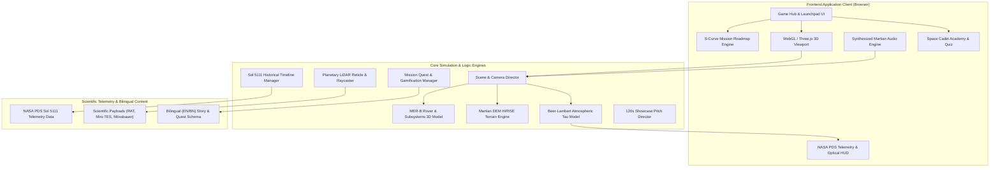

# 🛰️ RELICS OF THE RED DUST: THE LAST TRANSMISSION
## Complete Software Engineering (SWE) & Scientific Architecture Documentation

> **NASA Space Apps Challenge 2026 Submission**  
> **Topic**: Planetary Archaeology, MER-B Opportunity Rover Legacy & Atmospheric Optical Extinction Simulation  
> **Target Audiences**: Students, Youth, Educators, Space Enthusiasts, and Space Apps Evaluators  
> **Tech Stack**: Vanilla JavaScript (ES Modules), Three.js (WebGL), Vite, Custom Web Audio Synthesizer, CSS3 Glassmorphic Design System

---

## 📑 Documentation Index

| Document | Title | Description |
| :--- | :--- | :--- |
| **[01. Overview & SRS](./01_PROJECT_OVERVIEW_AND_SRS.md)** | **Software Requirements Specification (SRS)** | Problem statement, project scope, functional & non-functional requirements, and user personas. |
| **[02. Architecture & Design](./02_SYSTEM_ARCHITECTURE_AND_DESIGN.md)** | **System Architecture & Technical Design** | WebGL pipeline, procedural terrain DEM, optical physics (Beer-Lambert Tau 10.8), modular architecture, and component diagrams. |
| **[03. API & Data Specs](./03_API_AND_DATA_SPECIFICATIONS.md)** | **Data Structures & Module API Reference** | NASA PDS telemetry logs, payload schemas, bilingual data dictionaries, quest management, and subsystem engine references. |
| **[04. Space Apps Strategy](./04_NASA_SPACE_APPS_WINNING_STRATEGY_ALIGNMENT.md)** | **NASA Space Apps Alignment & Strategy** | Global judging criteria mapping, scientific data validity, 120-second pitch director breakdown, and educational impact. |
| **[05. Deployment Guide](./05_DEPLOYMENT_AND_MAINTENANCE_GUIDE.md)** | **Deployment, Optimization & Runbook** | Local setup, production build, 60 FPS performance optimizations, mobile responsiveness, and troubleshooting guide. |
| **[06. Production Blueprint & Script](./06_OFFICIAL_PRODUCTION_BLUEPRINT_AND_VIDEO_SCRIPT.md)** | **Official 240s Video Script & Proven Data Dossier** | Complete 4-minute video timeline, member roles, exact voiceover, director notes, and verified NASA scientific URLs. |
| **[📄 Official Blueprint DOCX](./NASA_Space_Apps_2026_Relics_of_the_Red_Dust_Official_Production_Blueprint.docx)** | **Master Word Document (.docx)** | Formatted official Word document for NASA Space Apps Challenge 2026 submission. |

---

## 🏗️ System High-Level Architecture Overview



---

## 🚀 Quick Start
```bash
# 1. Clone repository and navigate to root
cd /path/to/Nasa

# 2. Install dependencies
npm install

# 3. Run development server
npm run dev
# Server ready on http://localhost:3000/

# 4. Build for production
npm run build
```
