# Relics of the Cosmic Dust

### Abandoned but Not Forgotten — an interactive 3D story about NASA's discarded equipment on the Moon, Mars and in deep space

**2026 NASA International Space Apps Challenge · Team Relics**

| | |
| :-- | :-- |
| **Challenge** | Abandoned but Not Forgotten: Storytelling About NASA's Discarded Equipment on the Moon and Mars |
| **Theme** | The Next Frontier (2026) |
| **Difficulty** | Beginner / Youth (also suitable for Intermediate learners) |
| **Subjects** | Astrophysics · Planets & Moons · Space Exploration |
| **Format** | Interactive web-based 3D educational game (HTML, CSS, JavaScript, WebGL) |
| **Audience** | School-age space enthusiasts, ages 6–16, plus teachers and parents |
| **Languages** | English and Bengali (বাংলা), switchable at any time |
| **Screenshots** | All figures in this document are captured from the current build of the game (November 2026) |

---

## Table of Contents

1. [Project Summary](#1-project-summary)
2. [Project Demonstration](#2-project-demonstration)
3. [Project Details — the WHY, the WHAT and the HOW](#3-project-details--the-why-the-what-and-the-how)
   - 3.1 [The WHY — what problem we are solving](#31-the-why--what-problem-we-are-solving)
   - 3.2 [The WHAT — the game in one page](#32-the-what--the-game-in-one-page)
   - 3.3 [A guided tour of the game](#33-a-guided-tour-of-the-game)
   - 3.4 [The hardware we tell stories about](#34-the-hardware-we-tell-stories-about)
   - 3.5 [Science you can feel — the learning mechanics](#35-science-you-can-feel--the-learning-mechanics)
   - 3.6 [Designing for children — "the child stays in control"](#36-designing-for-children--the-child-stays-in-control)
   - 3.7 [The HOW — architecture and implementation](#37-the-how--architecture-and-implementation)
   - 3.8 [Testing and quality](#38-testing-and-quality)
   - 3.9 [Impact, community and future work](#39-impact-community-and-future-work)
4. [Responses to the Challenge Considerations](#4-responses-to-the-challenge-considerations)
5. [Tools and Technologies](#5-tools-and-technologies)
6. [Use of Artificial Intelligence](#6-use-of-artificial-intelligence)
7. [NASA Data, Resources and Space Agency References](#7-nasa-data-resources-and-space-agency-references)
8. [Team](#8-team)
9. [How to Run the Project](#9-how-to-run-the-project)

---

## 1. Project Summary

For more than sixty years NASA has left machines behind: landers and descent stages on the Moon, rovers and stations on Mars, and probes that are still flying away from the Sun. Children usually hear about missions that are active today. The older machines are rarely mentioned, or they are dismissed as "space junk".

**Relics of the Cosmic Dust** turns those machines into the heroes of a playable story. The player is a young *Planetary Archaeologist* working in the year 2085. Their job is to revisit the places where humanity left hardware behind, find each relic, scan it, and uncover **what it was built to do, what it discovered, and why it was left there**.

Instead of reading a list of facts, the child:

- **watches a one-minute tour** of the real game before they start;
- **drives a rover** across the Moon and Mars toward a glowing beacon;
- **chooses when to scan** a relic and reads its story in plain language;
- **tilts and inspects Voyager 1** in deep space, 24.3 billion km from Earth;
- **runs four interactive science labs** (rocket staging, X-ray spectroscopy, seismology, deep-space telemetry);
- **earns Cosmic Dust, Gems, XP, badges and a Master Certificate**.

The message the game is built to leave behind is one sentence:

> "When we leave something behind on the Moon or Mars, it is not 'space junk' — it is a permanent monument to human curiosity."

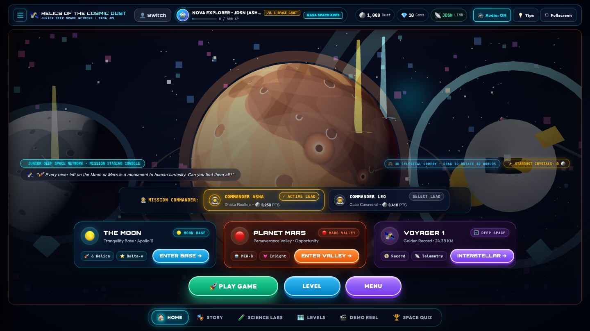

_Figure 1 — The Mission Control Hub. Three large gateways lead to The Moon, Planet Mars and Voyager 1. The background is a live, draggable 3D orrery._

---

## 2. Project Demonstration

| Item | Where |
| :-- | :-- |
| Playable web game | Run locally with `npm install` then `npm run dev` (see [Section 9](#9-how-to-run-the-project)); opens at `http://localhost:3000` |
| Game tour video (57 s) | `public/videos/game-tour.mp4` — a real gameplay recording, also played inside onboarding step 3 with English and Bengali captions |
| Source code | This repository (`src/`, `src/partials/`, `index.html`, `style.css`) |
| Pitch video script and production blueprint | `documentation/06_OFFICIAL_PRODUCTION_BLUEPRINT_AND_VIDEO_SCRIPT.md` |
| Submission documents | `final_doc/` (this document as Markdown, DOCX and PDF) |

> Public links (hosted demo, repository and video) are added to the submission form at hand-in time.

---

## 3. Project Details — the WHY, the WHAT and the HOW

### 3.1 The WHY — what problem we are solving

The challenge asks for a story that "introduces school-age space enthusiasts to the hardware and the science it made possible". We identified four obstacles that stop children from engaging with this history:

| Obstacle | What children experience today | How the game answers it |
| :-- | :-- | :-- |
| **Dense sources** | Mission archives are long technical pages and tables. | Every fact is delivered through an action: drive, scan, tilt, balance, align. |
| **Active missions get all the attention** | Retired hardware is invisible or called "junk". | Retired hardware is the *protagonist*; the player is the archaeologist who rediscovers it. |
| **Passive formats** | Videos and slides are watched, then forgotten. | A one-minute tour shows what is possible, then the child controls the camera, the rover and every discovery moment. |
| **Language and device barriers** | Most space content is English-only and needs a strong computer. | Full English/Bengali switch; runs in a normal browser with no install. |

Our central idea, **Planetary Archaeology 2085**, reframes the debate. In 2085 the landing sites are heritage monuments. The player is not cleaning up litter — they are *reading history from the objects themselves*.

### 3.2 The WHAT — the game in one page

| Layer | What it is |
| :-- | :-- |
| **Story frame** | A cadet of the *Junior Deep Space Network (JDSN)* in 2085, guided by two mission commanders: **Asha** (Dhaka, Bangladesh) and **Leo** (Cape Canaveral, Florida). |
| **Three worlds** | **The Moon** (Tranquility Base), **Mars** (Perseverance Valley) and **Deep Space** (Voyager 1). |
| **Companions** | Three selectable robot buddies: Astro-Bot "Echo", Cyber-Kitty "Nova", Rover-Drone "Orion". |
| **Onboarding** | A five-step briefing: Welcome (name and age), The Story, a one-minute game tour video, Meet the Bots, and Levels. |
| **In-game help** | Short tips that point at the real buttons the first time a child visits each screen, with a 💡 button to see them again. |
| **Progression** | A 6-level roadmap per world with XP, Cosmic Dust, Gems, badges, a quiz and a Master Certificate. |
| **Science labs** | Four hands-on JPL-style workbenches. |
| **Profiles** | Multiple cadets can share one device; each keeps independent progress. |

### 3.3 A guided tour of the game

#### Step 1 — Start screen and onboarding

A new visitor always starts on the Start Game screen. After pressing start, a five-step expedition briefing welcomes the cadet, explains the story, plays a short tour video, introduces the companion bots and previews the levels. The briefing can be switched to Bengali at any step, and closing it (✕ or Esc) always returns the child to the Game Hub.

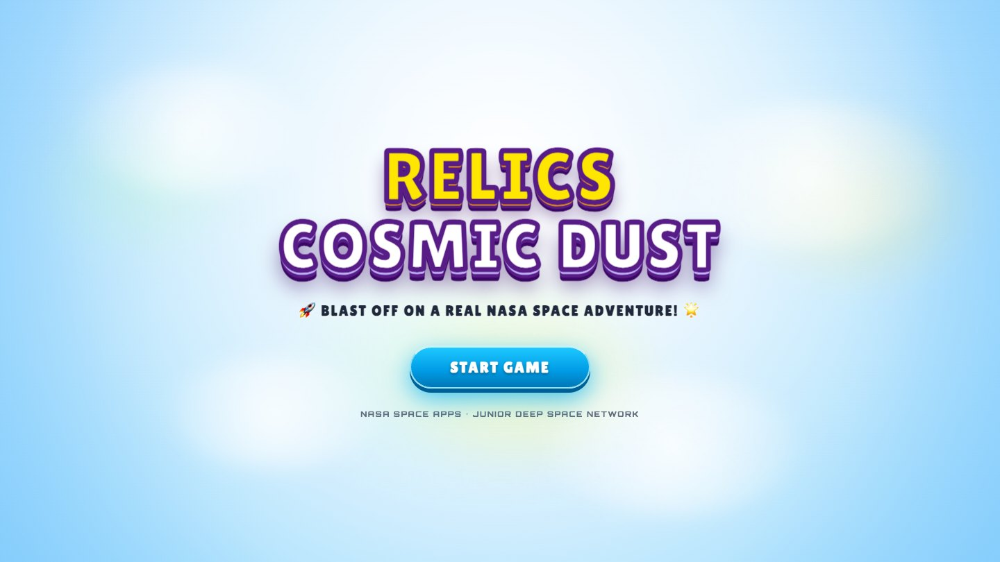

_Figure 2 — The Start Game screen shown to every new visitor and after logout: "Blast off on a real NASA space adventure!"_

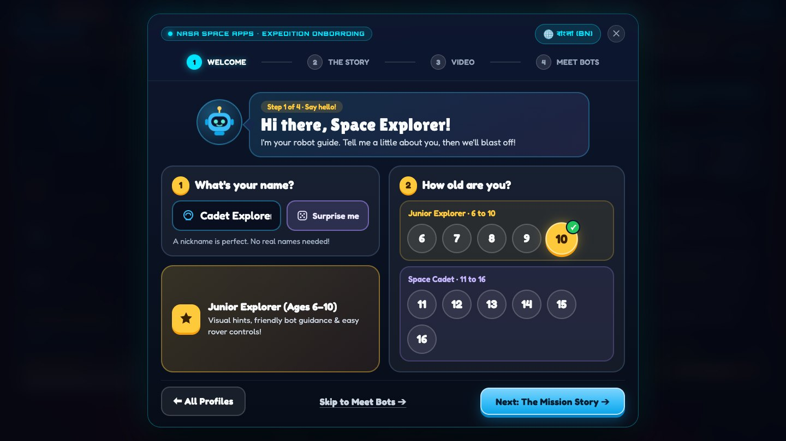

_Figure 3 — Onboarding step 1: a robot guide says hello. The child types a name (or presses **Surprise me** for a fun one) and taps their age. Ages are grouped into **Junior Explorer (6–10)** and **Space Cadet (11–16)**, and the age is saved to the cadet's profile._

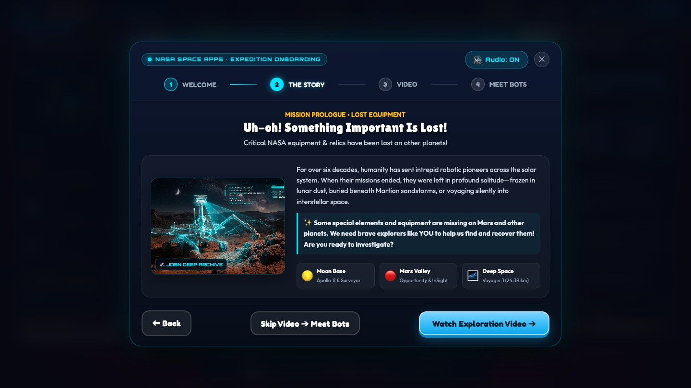

_Figure 4 — Onboarding step 2: the premise — robotic pioneers left behind, and the player's mission to find them._

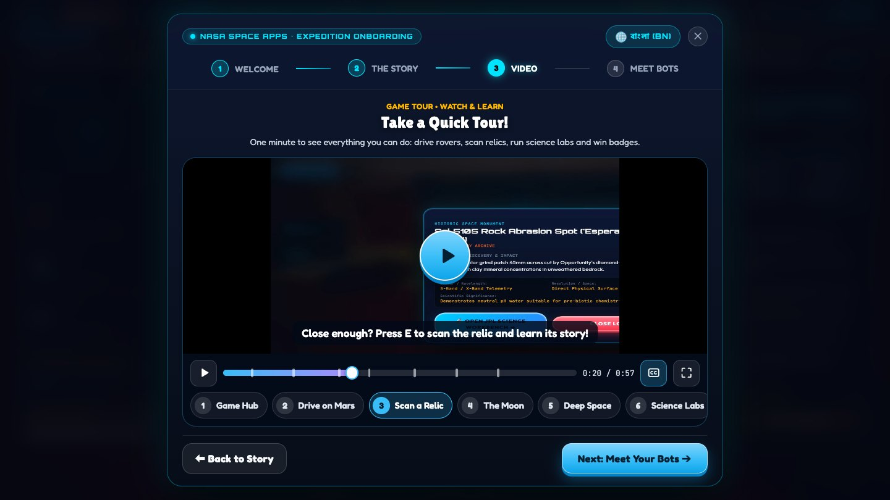

_Figure 5 — Onboarding step 3: a one-minute tour recorded from the real game. Captions follow the English/Bengali switch, and chapter buttons (Game Hub, Drive on Mars, Scan a Relic, The Moon, Deep Space, Science Labs, Quiz & Badges) let the child jump to any part._

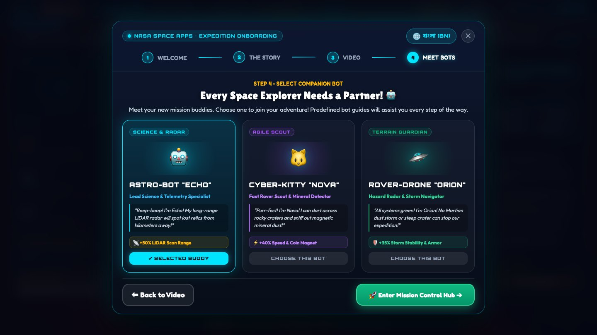

_Figure 6 — Onboarding step 4: choose a companion. Each bot has a different strength (+50% LiDAR range, +40% speed and coin magnet, or +35% storm stability)._

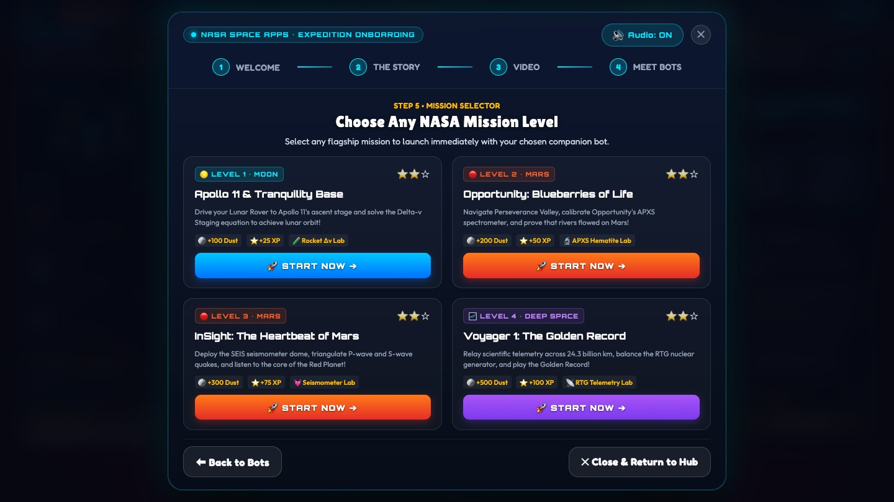

_Figure 7 — Onboarding step 5: a preview of the levels the cadet will unlock, each of which can be started directly._

#### Step 2 — The Mission Control Hub

The hub is designed to be understood by a child in seconds: **three big destination cards**, a one-line commander switcher, three large buttons (**Play Game**, **Level**, **Menu**) and a bottom bar of quick tabs (**Home, Story, Science Labs, 3D Space, Drive Rover, Levels, Demo Reel, Space Quiz**). Hovering a destination makes the 3D background fly to that world.

The first time a child reaches the hub, short tips point at the main buttons one at a time. Each tip can be skipped, and **Don't show tips again** turns them off everywhere; the 💡 **Tips** button brings them back at any time.

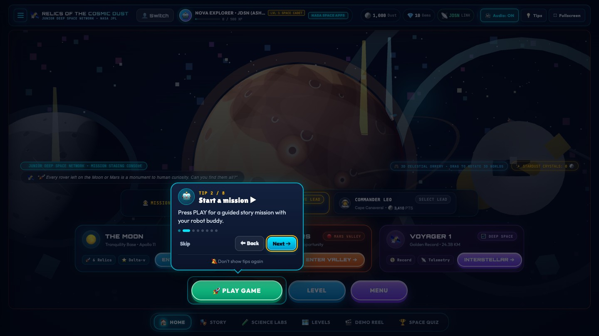

_Figure 8 — A first-visit tip: the rest of the screen dims, the Play Game button is highlighted, and the robot guide explains what it does. The highlighted button still works, so tapping it is the same as "got it"._

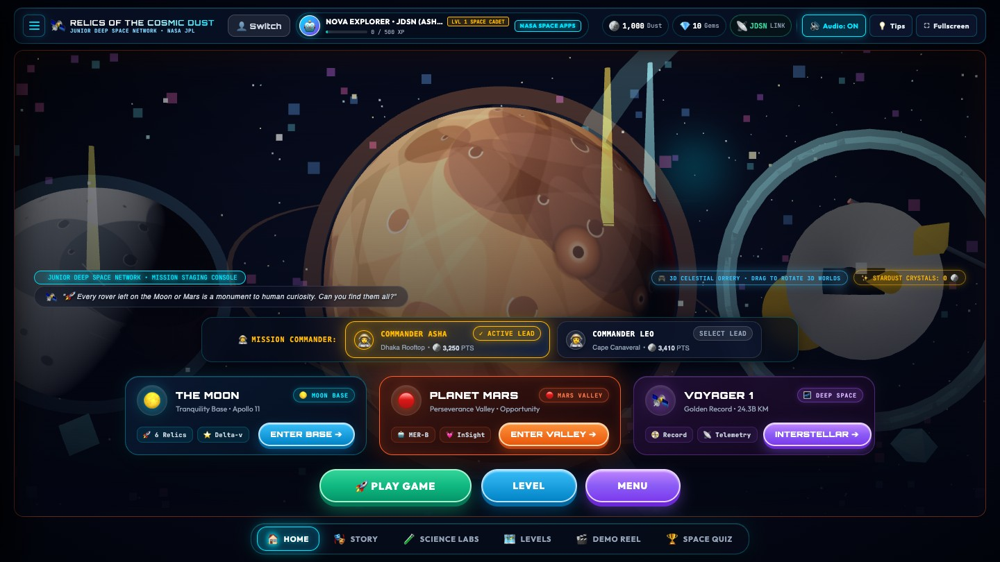

_Figure 9 — Hover effect: pointing at "Planet Mars" focuses the 3D background on Mars, so the child sees where they are about to go._

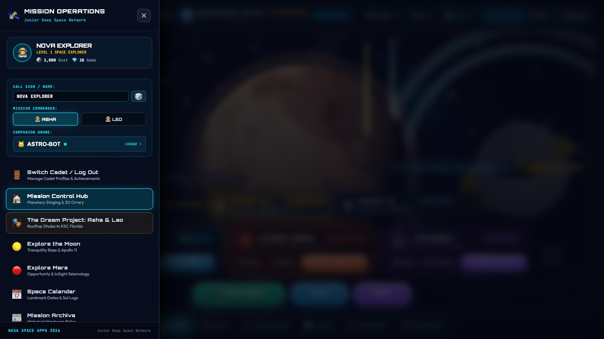

_Figure 10 — The Menu drawer: call sign, commander, companion, quick links to the Prologue, Moon, Mars, Calendar, Archive, Labs, Quiz, Badges, Roadmap and more._

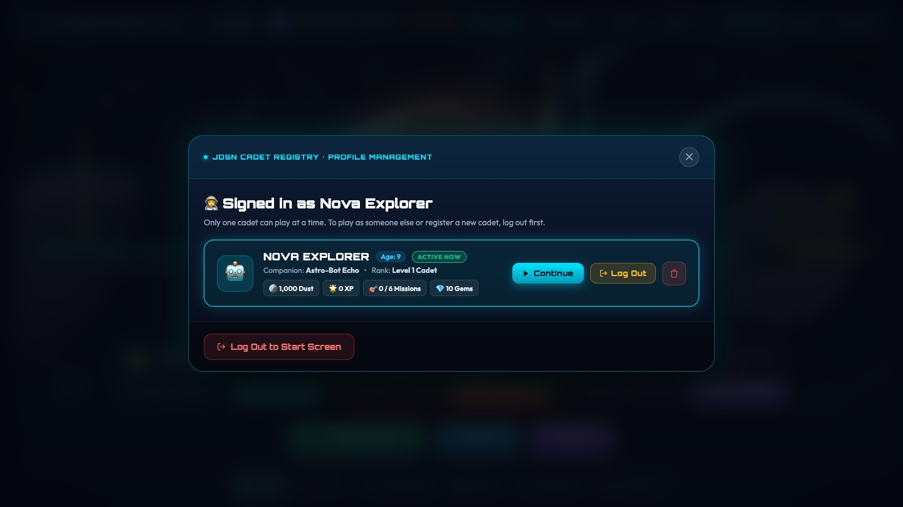

_Figure 11 — The Cadet Registry. Several children can share a device; each profile has its own Dust, Gems, XP, mission progress and tip settings, and **Log Out** returns to a fresh Start screen._

#### Step 3 — Explore the Moon

Pressing **Enter Base** places the child directly in a lunar rover on the surface. A glowing beacon marks the first relic, the HUD shows the mission and the distance, the radar map in the bottom-right corner tracks the target, and the companion bot gives a one-sentence hint. **Back to Hub** and the 💡 tips button sit together in the top-left corner on every game screen.

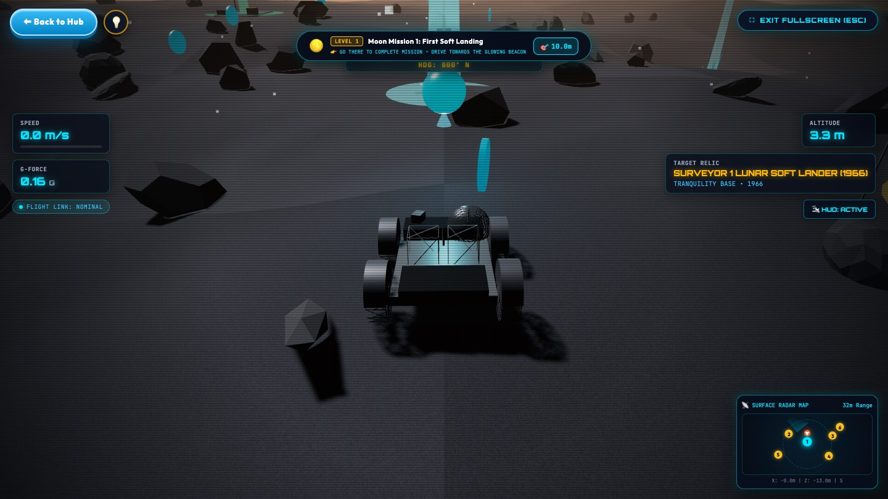

_Figure 12 — The lunar rover at the start of Moon Mission 1, "First Soft Landing". The top bar shows the mission and the distance to the target (32 m); the right panel names the target relic, Surveyor 1._

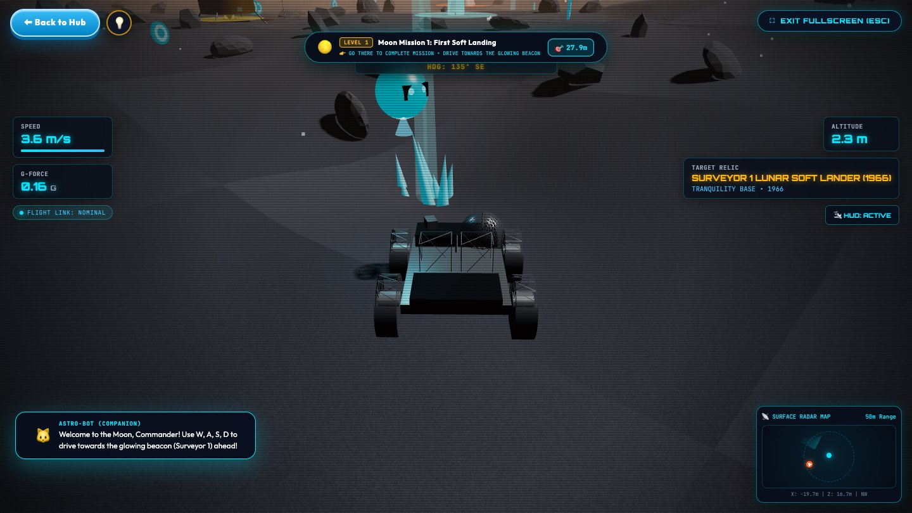

_Figure 13 — The child drives with **W / A / S / D** or the arrow keys (on-screen controls on touch devices). The radar map shows the rover as an arrow and the relic as a glowing dot._

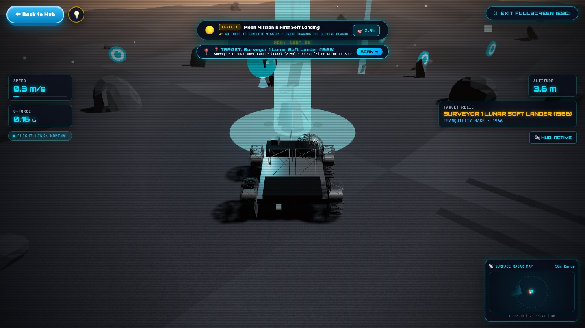

_Figure 14 — Within about 4.5 m of the relic the game offers a scan. Nothing happens until the child presses **E** or taps **Scan**._

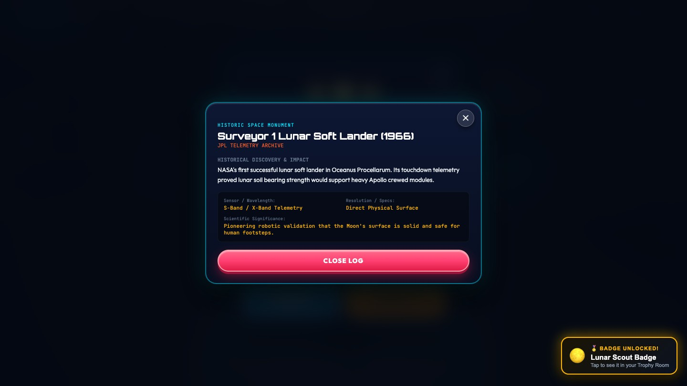

_Figure 15 — The relic log: what the machine is, what it discovered, and why it matters, in plain language._

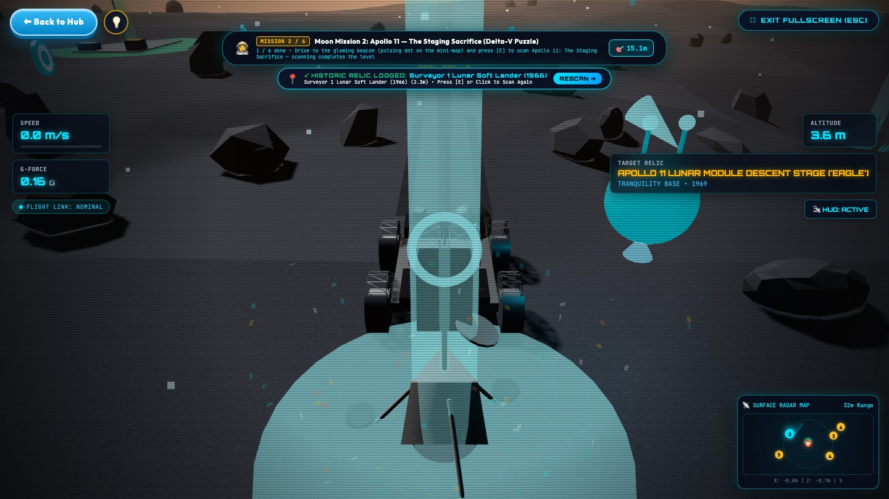

_Figure 16 — After the scan the relic is logged, XP and Cosmic Dust are awarded, and the beacon moves to the next mission — here Mission 2, the Apollo 11 "Eagle" descent stage._

#### Step 4 — Explore Mars

On Mars the rover starts 32 m from the first relic, the **Opportunity (MER-B)** rover, in Perseverance Valley. The same drive → scan → discover loop applies, now with the real story of a rover built for 90 days that worked for more than fourteen years.

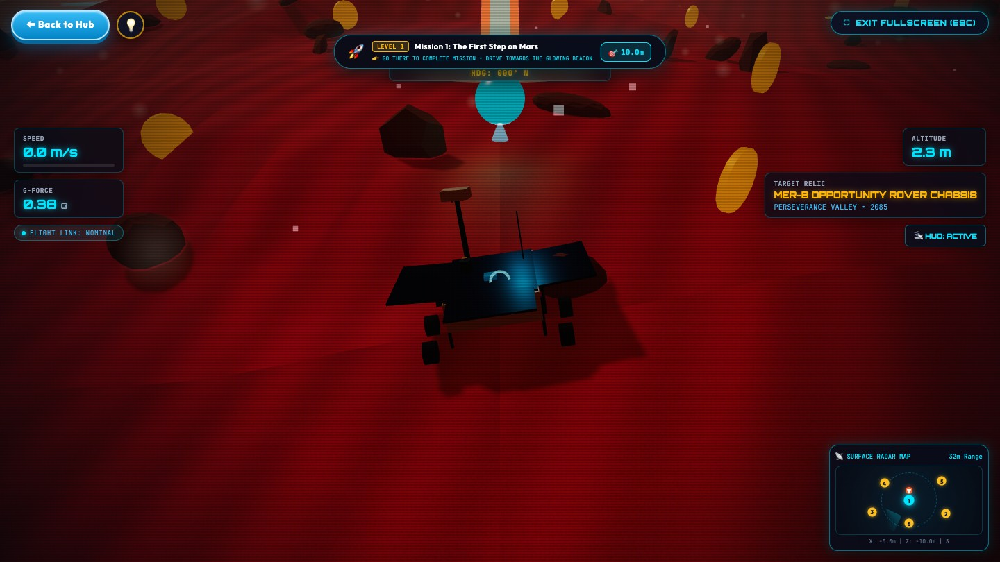

_Figure 17 — Mars Mission 1: "The First Step on Mars". The companion bot explains the controls._

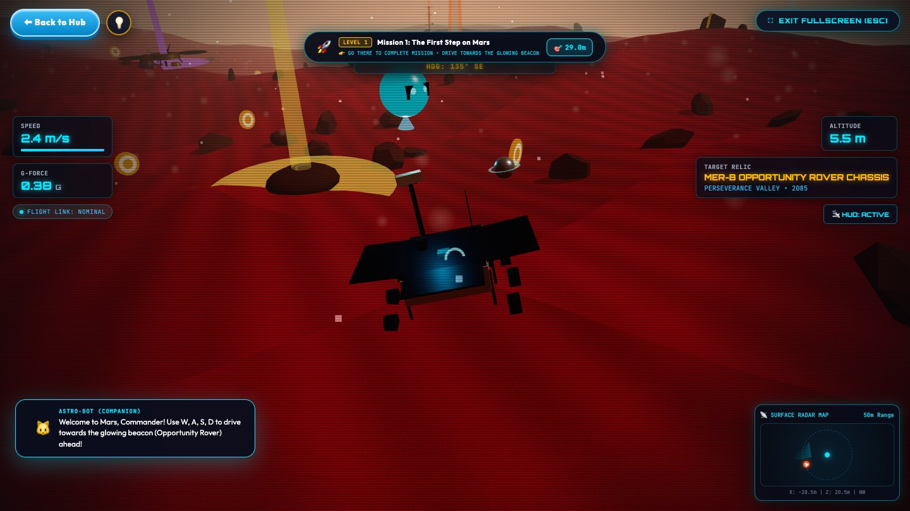

_Figure 18 — Driving across the Martian terrain toward Opportunity._

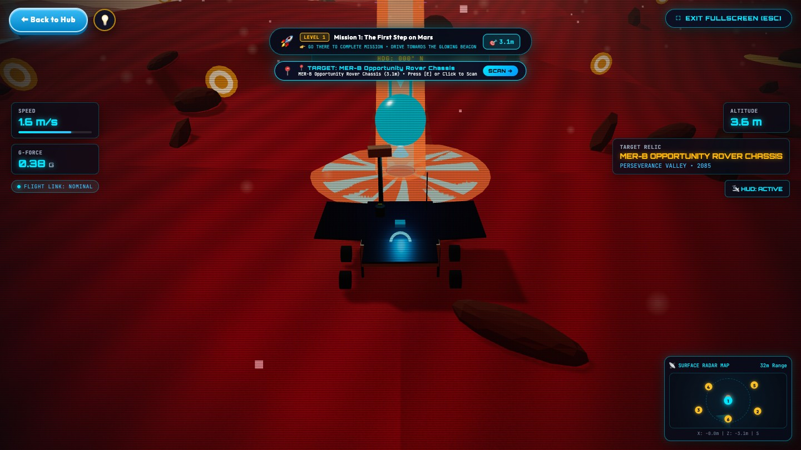

_Figure 19 — Reaching Opportunity. The scan prompt appears only when the child is close enough._

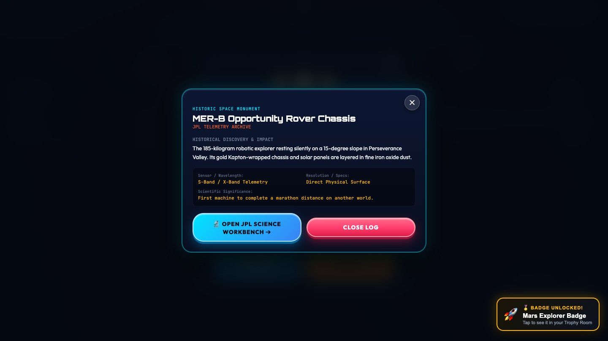

_Figure 20 — The Opportunity relic log. Relics linked to a science lab offer **Open JPL Science Workbench**; **Close Log** returns to driving._

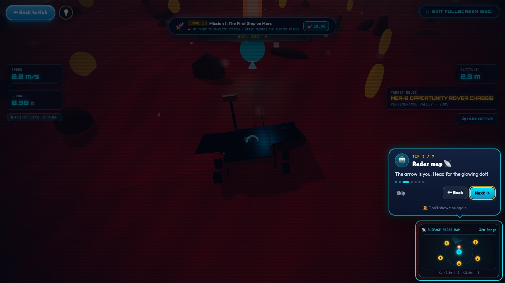

_Figure 21 — The first time a child enters a world, tips explain the driving keys, the goal tracker, the radar map, scanning with E, Back to Hub and the 💡 button. Tips for buttons that are not on screen are skipped automatically._

#### Step 5 — Roadmap and levels

Each world has a six-level, winding roadmap. Completed levels glow; the next level is highlighted; the final stop is the Master Certificate.

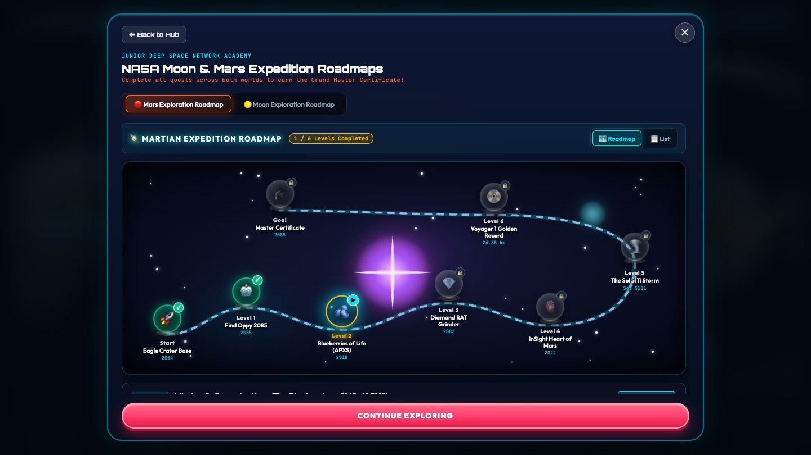

_Figure 22 — The Mars Exploration Roadmap: Eagle Crater Base → Find Oppy → Blueberries of Life (APXS) → Diamond RAT Grinder → InSight Heart of Mars → The Sol 5111 Storm → Voyager 1 Golden Record → Master Certificate. A second tab shows the Moon roadmap._

#### Step 6 — Deep Space with Voyager 1

In deep space there is no ground, so the game becomes an inspection scene. The child rotates Voyager 1 with **W / A / S / D** and inspects its parts — high-gain dish, RTG power source, Golden Record — while the HUD reminds them that a radio message takes **22 hours 34 minutes** to arrive.

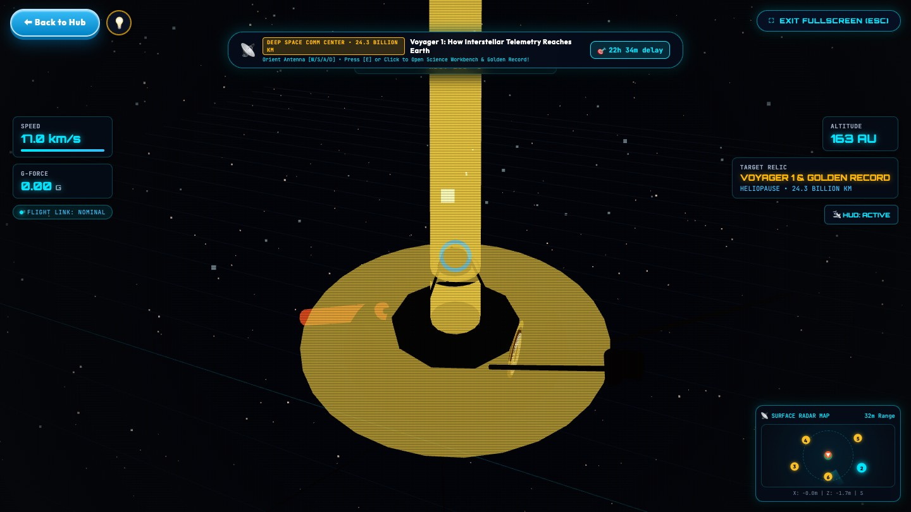

_Figure 23 — Voyager 1 at 24.3 billion km. The Science Lab opens only when the child chooses it (press **E** or click)._

#### Step 7 — Four hands-on science labs

Each lab turns one real piece of science into a small puzzle with a commander giving context.

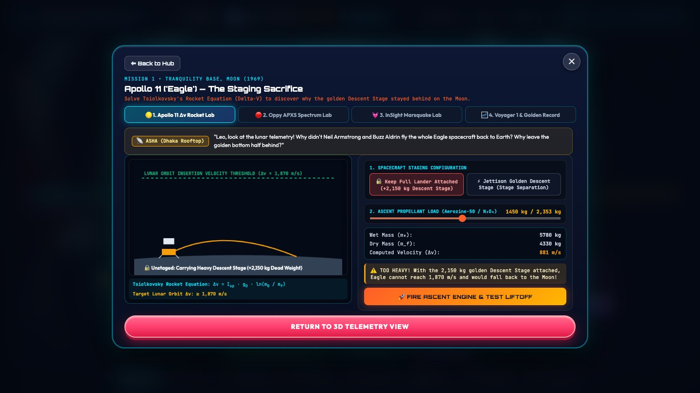

_Figure 24 — Lab 1: **Apollo 11 Δv Rocket Lab**. Why did the astronauts leave the heavy descent stage on the Moon?_

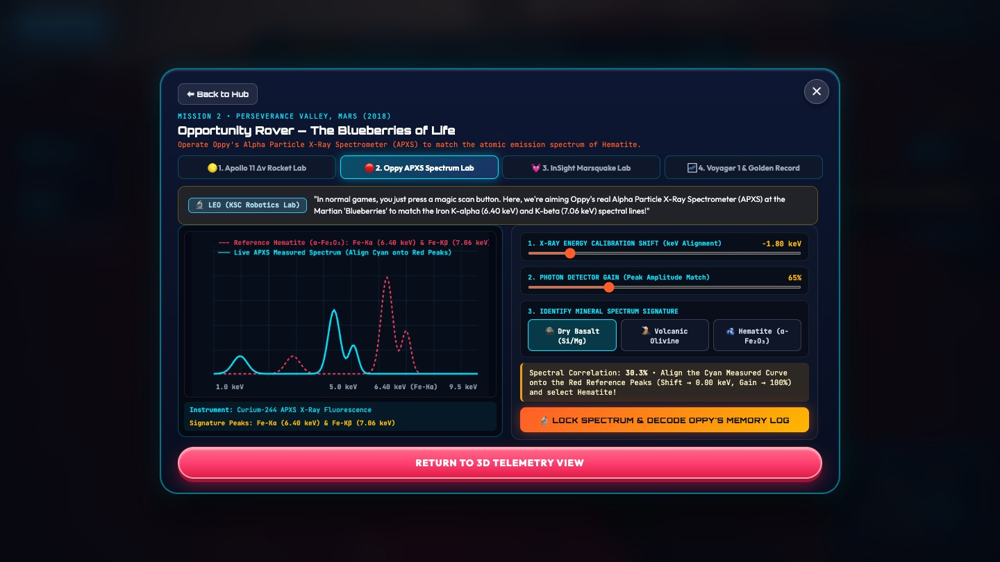

_Figure 25 — Lab 2: **Oppy APXS Spectrum Lab**. Align X-ray peaks to identify the iron in the "blueberries" that proved Mars once had liquid water._

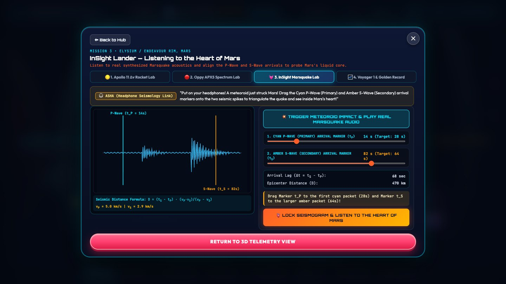

_Figure 26 — Lab 3: **InSight Marsquake Lab**. Match P-waves and S-waves to listen to the heart of Mars._

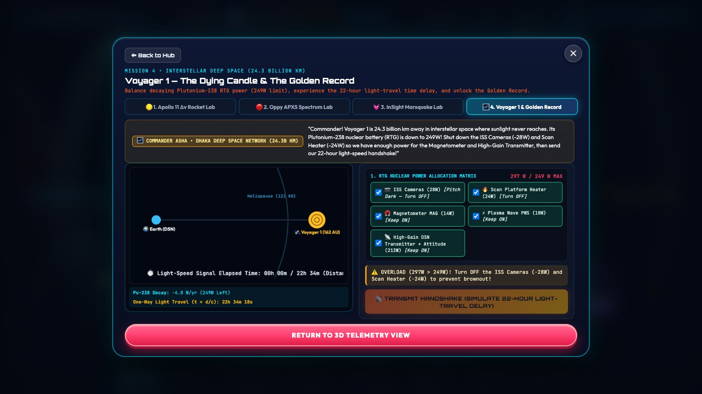

_Figure 27 — Lab 4: **Voyager 1 & Golden Record**. Balance a decaying plutonium power budget, then transmit a handshake across the 22-hour light delay._

#### Step 8 — Quiz and certificate

After exploring, the child can test their knowledge in the Space Cadet Quiz and compare ranks on the leaderboard. Finishing every mission on a world unlocks the printable Master Certificate.

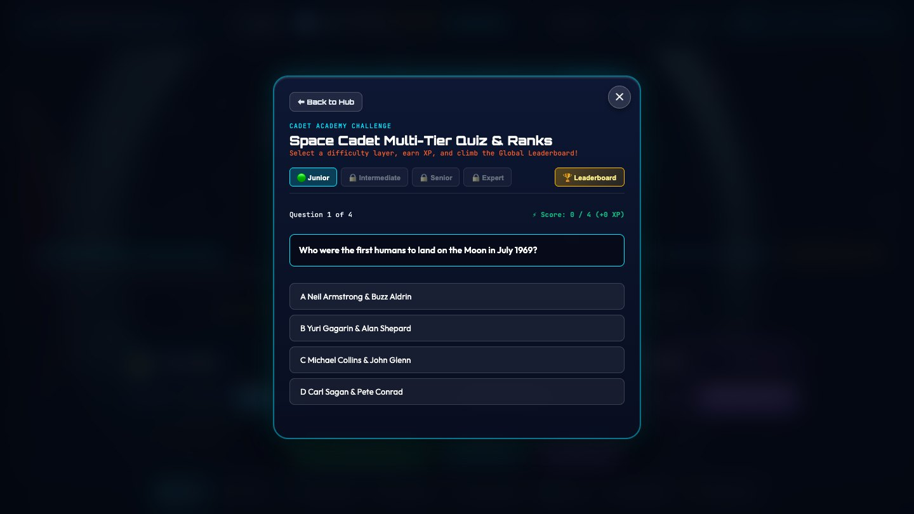

_Figure 28 — The quiz and leaderboard, which reinforce what the child discovered during play._

### 3.4 The hardware we tell stories about

Every relic in the game is real NASA hardware. Each one is paired with one clear idea a child can carry away.

#### The Moon

| Level | Relic | Year | The story in one sentence |
| :-- | :-- | :-- | :-- |
| 1 | **Surveyor 1** | 1966 | The first U.S. soft landing on the Moon proved the surface was firm, not a sea of dust that would swallow a spacecraft. |
| 2 | **Apollo 11 Lunar Module "Eagle"** | 1969 | The golden descent stage was left behind on purpose to save fuel for the trip home — the rocket equation in action. |
| 3 | **Surveyor 3** | 1969 | Apollo 12 astronauts walked to it and brought parts back: the first off-world archaeology. |
| 4 | **Lunar Roving Vehicle** | 1971 | A battery-powered buggy that drove in one-sixth gravity. |
| 5 | **LCROSS** | 2009 | A mission that confirmed water ice in a permanently shadowed lunar crater. |
| 6 | **Artemis era** | 2026 | The return to the Moon, built on the lessons of the relics above. |

#### Mars

| Level | Relic | Year | The story in one sentence |
| :-- | :-- | :-- | :-- |
| 1 | **Opportunity (MER-B)** | 2004–2018 | Built for 90 sols, it worked for 5,111 — about 57 times longer than planned. |
| 2 | **Hematite "blueberries"** (APXS) | 2004 | Tiny iron-rich spheres showing that liquid water once soaked this ground. |
| 3 | **Rock Abrasion Tool (RAT)** | 2004+ | A diamond grinder that cleaned dust from rock to reveal what lay beneath. |
| 4 | **InSight lander** | 2018–2022 | Its seismometer recorded 1,319 marsquakes and revealed Mars's core. |
| 5 | **Sol 5111 dust storm** | 2018 | A planet-wide storm blocked the sunlight and silenced Opportunity: *"My battery is low and it's getting dark."* |
| 6 | **Voyager 1 & the Golden Record** | 1977– | A gold-plated disc of Earth's sounds, music and greetings in 55 languages, now in interstellar space. |

#### Deep space

| Relic | Story |
| :-- | :-- |
| **Voyager 1** | Launched in 1977, now more than 24 billion km away and still sending data using a plutonium power source that weakens every year. |

### 3.5 Science you can feel — the learning mechanics

The game never asks a child to memorise an equation. It lets them feel the idea first, and names it second.

| Idea | Where the child meets it | What they actually do |
| :-- | :-- | :-- |
| **Rocket staging and Δv** | Apollo 11 lab | Decide what to drop to reach orbit with limited fuel. |
| **Spectroscopy** | Opportunity APXS lab | Line up X-ray peaks to identify iron in a rock. |
| **Seismology** | InSight lab | Match P-wave and S-wave arrival times to find a quake's distance. |
| **Power budgets** | Voyager lab | Switch off instruments so the power draw drops below what the RTG can supply. |
| **Light-travel time** | Voyager HUD and lab | See why a message to a probe 24.3 billion km away takes 22 h 34 min. |
| **Dust and sunlight** | Mars Sol 5111 level | See how atmospheric dust reduces solar-panel power. |
| **Low gravity** | Moon and Mars HUD | Watch the G-force read-out change between the Moon (0.16 g) and Mars (0.38 g). |

### 3.6 Designing for children — "the child stays in control"

During testing we found that children dislike being interrupted, but also get lost without help. We therefore made a deliberate rule:

> The game never takes an action *for* the child. It only offers a choice — and help is offered once, then gets out of the way.

| Moment | What we removed or changed | What the child controls now |
| :-- | :-- | :-- |
| First screen | Small, all-caps text and tiny controls. | Rounded, readable fonts, big age bubbles and buttons of at least 44 px, and a robot guide that says hello. |
| Closing the briefing | ✕ dropped the child into the 3D game. | ✕ or Esc returns to the Game Hub. |
| Start of a world | An automatic roadmap pop-up and an automatic radio dialogue. | The rover is simply ready to drive. |
| Reaching a relic | An automatic history pop-up that froze the rover. | A *scan prompt* appears; the child chooses when to scan. |
| After a scan | An automatic rocket animation and automatic next-level spawn. | The relic log stays until the child closes it or opens the science lab; then the next beacon lights up. |
| First visit to a screen | A long tour overlay. | Short tips that point at the real buttons, shown once per screen per cadet; **Skip**, Esc or **Don't show tips again**; the 💡 button replays them. |
| Deep space | An automatic science-lab pop-up. | Pressing E or clicking opens the lab when wanted. |
| Every screen | Dead ends. | A visible **Back to Hub** button on every game screen. |
| Reload | Losing your place. | Progress and the active cadet are restored; logging out returns to a clean Start screen. |

### 3.7 The HOW — architecture and implementation

```
┌──────────────────────── Browser (no install) ────────────────────────┐
│  index.html  ->  assembled at build time from src/partials/**        │
│  style.css      (hub, HUD, modals, onboarding wizard, tips)          │
│                                                                      │
│  src/main.js  (game director)                                        │
│   ├─ renderer/        Three.js scenes: Mars, Moon, deep-space actors │
│   ├─ systems/                                                        │
│   │   ├─ roverControls.js      rocker-bogie rover, W/A/S/D, slope    │
│   │   ├─ scanner.js            raycast + manual scan, relic data     │
│   │   ├─ quests.js             missions, XP, badges, certificate     │
│   │   ├─ minigames.js          the four science labs                 │
│   │   ├─ profileManager.js     multi-cadet profiles in localStorage  │
│   │   ├─ coachmarks.js         first-visit tips for every screen     │
│   │   ├─ hero3DOrrery.js       hub 3D solar-system background        │
│   │   ├─ audio.js              Web Audio synthesised sound           │
│   │   └─ kittyCompanionManager.js  companion bots and guidance       │
│   └─ data/            relic, mission and telemetry data              │
│  public/videos/       game tour video and poster                     │
└──────────────────────────────────────────────────────────────────────┘
```

| Concern | Implementation |
| :-- | :-- |
| **3D rendering** | Three.js (WebGL) with procedurally generated terrain modelled on the character of lunar and Martian surfaces; custom lighting, fog and atmosphere per world. |
| **Rover physics** | Six-wheel rocker-bogie style rover that follows terrain height, tilts on slopes and reports speed, heading, G-force and altitude. |
| **Guidance** | A cyan beacon pillar, a distance read-out, a radar map and a companion-bot hint — four independent cues so a child is never lost. |
| **Discovery loop** | Proximity check → scan prompt → child scans → relic log → rewards → next beacon. |
| **First-visit tips** | `coachmarks.js` detects which screen is showing, waits until nothing else is open, then spotlights one real button at a time with an arrow bubble. Steps for hidden buttons are skipped; "seen" and "tips off" are stored per cadet profile. |
| **Onboarding** | Five-step wizard with kid-friendly cards (name with "Surprise me", colour-coded age groups) and a captioned tour video with chapters, scrubbing and full-screen. |
| **Progress and profiles** | Each cadet's name, age, bot, Dust, Gems, XP and completed missions are stored in `localStorage` under their own profile; logout clears the active session without deleting profiles. |
| **Audio** | Procedural Web Audio (UI clicks, scanner beeps, thruster puffs, transmission tones) — no audio downloads required. |
| **Localisation** | English and Bengali strings switch instantly across the wizard, tips, video captions, HUD, missions and labs. |
| **Hub background** | A live, draggable Three.js orrery of the Moon, Mars and Voyager 1 that flies to the world a child points at. |
| **Build and performance** | Vite; a small build plugin assembles `index.html` from HTML partials; single-page; runs at interactive frame rates in a normal laptop browser. |

### 3.8 Testing and quality

- **Automated end-to-end capture.** Every screenshot in this document was captured automatically from the production build by a headless Chrome script that played the *real* game: onboarding → hub → launch the Moon → steer the rover to the mission's target using the radar map → press **E** → relic log, and the same for Mars, then the roadmap, Voyager and all four labs.
- **Tour video.** The onboarding video was recorded the same way, from real gameplay, and encoded to a 1280×720 MP4 (about 4.5 MB).
- **Layouts and languages.** The onboarding, tips and video player were checked at desktop (1440 px) and phone (390 px) widths, in English and Bengali.
- **Bug-fix pass** carried out before submission: profile and logout persistence, duplicate-profile prevention, hub navigation, the onboarding ✕ button, overlapping modal buttons, the radar map hiding under the Back to Hub button, and the removal of every automatic interruption listed in [Section 3.6](#36-designing-for-children--the-child-stays-in-control).
- **Production build** compiles cleanly with `npm run build`.

### 3.9 Impact, community and future work

**Who benefits**

- **Students (6–16)** meet real NASA history through play instead of text.
- **Teachers and parents** get a classroom-ready, no-install tool with built-in quiz and certificate.
- **Bengali-speaking learners** get first-class support rather than an afterthought.
- **Siblings and classmates** can share one device with separate profiles.

**A global perspective.** The two mission commanders — **Asha** at a rooftop antenna ground station in Dhaka and **Leo** at a flight-telemetry console near Cape Canaveral — show that space exploration belongs to children everywhere.

**Roadmap**

| Next step | Why |
| :-- | :-- |
| More relics: Viking, Pathfinder/Sojourner, Curiosity, Perseverance/Ingenuity | Broader story across more decades. |
| Chinese, Indian and European relics | Wider international view of discarded hardware. |
| Age-adaptive hints and difficulty based on the age chosen in onboarding | A better fit for both 6-year-olds and 16-year-olds. |
| Teacher dashboard (class progress export) | Classroom adoption. |
| More languages | Reach more learners. |
| Narrated audio mode and a narrated tour video | Further accessibility for early readers. |

---

## 4. Responses to the Challenge Considerations

### What age group is your story designed for?

**School-age children, 6 to 16.** The language is simple, each discovery has a one-sentence takeaway, and the controls are the familiar W/A/S/D. Younger players can enjoy the driving, rewards, companion bots and first-visit tips; older students can go deeper in the science labs and the harder quiz tiers (Junior, Intermediate, Senior, Expert). Each cadet's age is recorded in their profile during onboarding. Teachers and parents are a secondary audience.

### How accessible is the format you chose to use?

| Barrier | Our answer |
| :-- | :-- |
| Software installation | None — it runs in a web browser. |
| Powerful hardware | Procedural graphics keep downloads small and run on ordinary laptops. |
| Language | Complete English and Bengali switch, including tips and video captions. |
| Reading level | Short sentences, rounded readable fonts and large tap targets (at least 44 px). |
| Input device | Keyboard (W/A/S/D, E) and on-screen touch controls; tips and the video player work with the keyboard. |
| Hearing | Every spoken or audio cue also appears as on-screen text; the tour video has captions. |
| Motion sensitivity | The onboarding animations, tips and tour-video autoplay respect the "reduce motion" setting. |
| Getting lost | Beacon, distance read-out, radar map and bot hint; first-visit tips; a **Back to Hub** button on every screen. |
| Shared devices | Multi-cadet profiles with a clean logout. |

### Do you want to focus on specific missions and pieces of equipment, or tell a broader story about NASA's exploration?

**Both.** Each level focuses on one specific machine — Surveyor 1, the Apollo 11 descent stage, Opportunity, InSight, Voyager 1 — and teaches its purpose and discovery in detail. The roadmaps then connect those machines into one arc: *each robot made the next mission possible*.

### What perspective(s) do you want to highlight?

1. **The machines' perspective** — they are explorers with stories, not litter.
2. **The future archaeologist** — in 2085 these sites are heritage monuments.
3. **A global youth perspective** — commanders in Dhaka and Florida, content in English and Bengali.
4. **The scientist's perspective** — every discovery is tied to a real measurement or physical idea.

---

## 5. Tools and Technologies

| Area | Tools |
| :-- | :-- |
| Languages | JavaScript (ES modules), HTML5, CSS3 |
| 3D and graphics | Three.js, WebGL, procedural terrain and shaders |
| Audio | Web Audio API (synthesised) |
| Build | Vite (with a small HTML-partials plugin), Node.js |
| Libraries | canvas-confetti (celebrations), marked (document generation), docx (Word export) |
| Design | Dark space interface with kid-friendly rounded type (Lilita One, Fredoka), SVG icons, responsive layout |
| Video | Real gameplay recorded with headless Chrome and encoded with FFmpeg (H.264 MP4) |
| Documentation | Markdown, DOCX and PDF generated from one source by `scripts/build-final-docs.mjs` |
| Testing | Headless Chrome (Puppeteer) driving the real game flow on desktop and phone widths |

---

## 6. Use of Artificial Intelligence

In line with the Space Apps guidance, we state clearly how AI was used:

- **Coding assistance.** An AI coding assistant helped us write, review and debug parts of the code — for example the profile/logout flow, the hub redesign, the removal of automatic pop-ups, the first-visit tips, the kid-friendly onboarding cards, and the scripts that capture screenshots and record the tour video.
- **Writing support.** AI helped us draft and polish documentation and check Bengali phrasing.
- **Human responsibility.** The concept (Planetary Archaeology 2085), the story, the choice of relics and facts, the game design, and all final decisions were made by the team. We reviewed and tested every AI-assisted change by running the game.
- **No AI-generated gameplay content at runtime.** The game contains no live generative AI; everything a child sees is authored and fixed. The tour video is a recording of the real game, not generated footage.

---

## 7. NASA Data, Resources and Space Agency References

| Source | How it informed the project |
| :-- | :-- |
| **NASA Planetary Data System (PDS)** — MER-B Opportunity | Mission timeline (landing 2004, Sol 5111 in 2018), dust-storm opacity and power figures used in the Mars story and levels. |
| **NASA Mars Reconnaissance Orbiter / HiRISE** | Reference for the character of Perseverance Valley terrain used to shape the procedural Mars surface. |
| **NASA Lunar Reconnaissance Orbiter / LOLA** | Reference for lunar terrain character used to shape the procedural Moon surface. |
| **NASA mission archives** — Surveyor 1 and 3, Apollo 11 and 12, LRV, LCROSS | Historical facts, dates and relic descriptions. |
| **NASA/JPL** — InSight and Voyager | Seismology facts (marsquake count) and Voyager facts (distance, 22 h 34 min light time, RTG decay, Golden Record). |
| **NASA Eyes on the Solar System** | Inspiration for the hub's interactive 3D solar-system view. |
| **NASA 3D Resources and JPL hardware references** | Reference for the shapes and proportions of the hardware models. |

Detailed data notes are kept in `documentation/NASA_DATA_SOURCES.md`.

> Terrain and hardware in the game are procedural and illustrative, informed by these sources rather than copied from them. Facts, dates and figures are drawn from NASA public sources.

---

## 8. Team

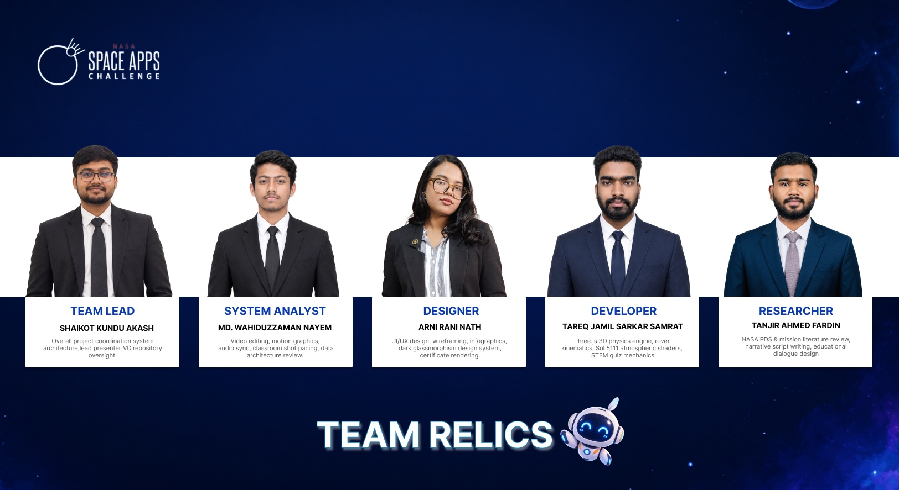

_Team Relics — NASA International Space Apps Challenge 2026._

| Member | Role | Responsibilities |
| :-- | :-- | :-- |
| **Shaikot Kundu Akash** | Team Lead | Overall project coordination, system architecture, lead presenter voice-over, repository oversight |
| **Md. Wahiduzzaman Nayem** | System Analyst | Video editing, motion graphics, audio sync, classroom shot pacing, data architecture review |
| **Arni Rani Nath** | Designer | UI/UX design, wireframing, infographics, dark glassmorphism design system, certificate rendering |
| **Tareq Jamil Sarkar Samrat** | Developer | Three.js 3D physics engine, rover kinematics, Sol 5111 atmospheric shaders, STEM quiz mechanics |
| **Tanjir Ahmed Fardin** | Researcher | NASA PDS and mission literature review, narrative script writing, educational dialogue design |

---

## 9. How to Run the Project

```bash
# 1. Install dependencies
npm install

# 2. Start the development server (http://localhost:3000)
npm run dev

# 3. Build for production
npm run build
```

**Controls**

| Action | Keyboard | Touch |
| :-- | :-- | :-- |
| Drive rover | W / A / S / D or arrow keys | On-screen steering buttons |
| Scan a relic | E | Scan button |
| Rotate Voyager 1 | W / A / S / D | Drag |
| Show tips again | 💡 button | 💡 button |
| Skip tips | Esc or **Skip** | **Skip** |
| Back to hub | **Back to Hub** button | **Back to Hub** button |
| Leave full-screen | Esc or F | Exit button |

---

*Team Relics · 2026 NASA International Space Apps Challenge*
