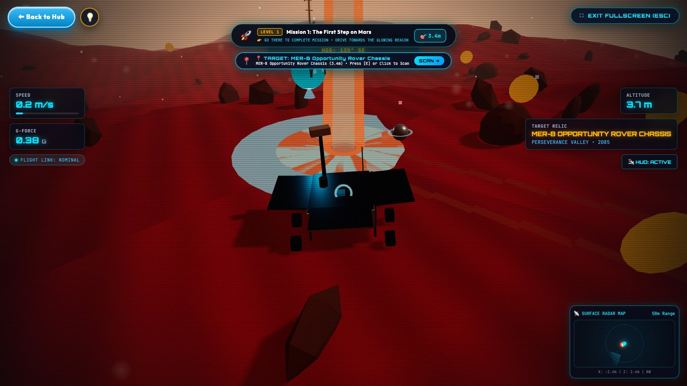
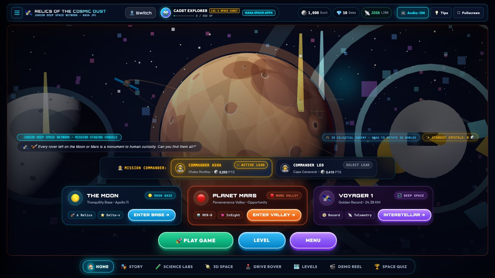
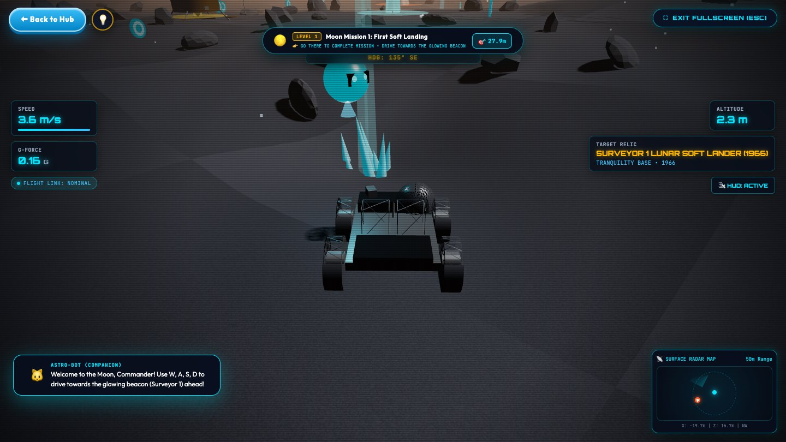
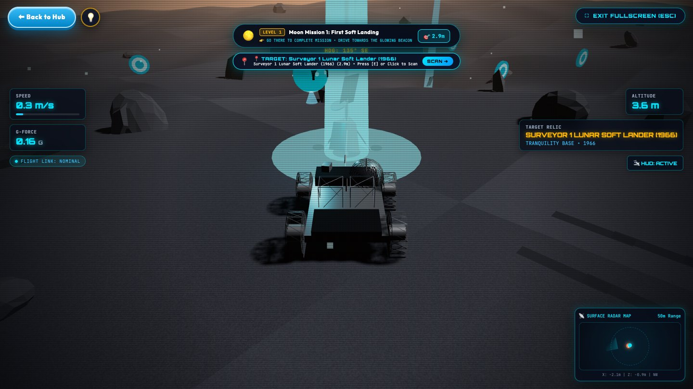
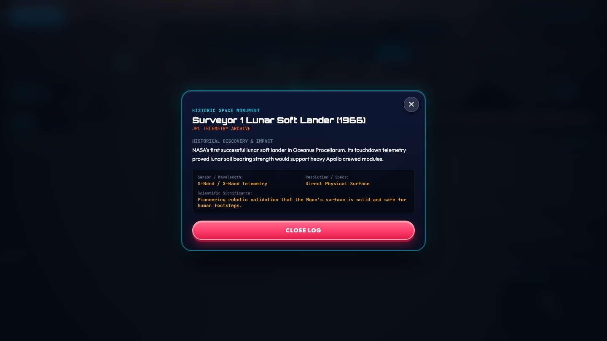
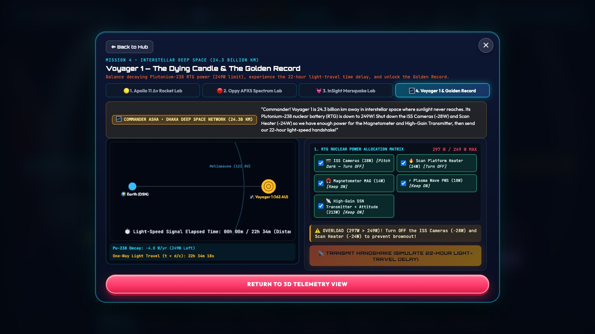
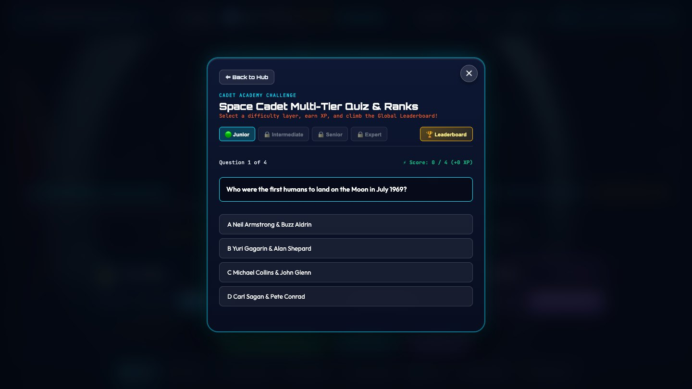

# Relics of the Cosmic Dust

### 30-Second Video — Script, Shot List and Production Guide

**2026 NASA International Space Apps Challenge · Team Relics**

| | |
| :-- | :-- |
| **Runtime** | 0:30 exactly |
| **Purpose** | Our "30 Seconds of Glory" video for global nomination |
| **Structure** | Space Apps model: 0:00 introduce yourself → 0:02 lead us in → 0:05 name your solution → 0:10 describe your idea → 0:20 look into the future |
| **Format** | 1920 × 1080, 30 fps, H.264 MP4, stereo AAC audio |
| **Voice** | Shaikot on camera for the first 2 seconds, then voice-over; about 55 words |
| **Captions** | Burned-in English captions; every line also works as on-screen text with the sound off |
| **Footage** | Real game footage from the current build, plus a 2-second shot of Shaikot |

---

## 1. Script

| Time | Space Apps step | Visual | On screen (text) | Voice-over / spoken line |
| :-- | :-- | :-- | :-- | :-- |
| 0:00 – 0:02 | **Introduce yourself** | Shaikot on camera, smiling, game hub softly blurred behind him. | Shaikot Kundu Akash · Team Relics, Bangladesh | **On camera (Shaikot):** "Hi, I'm Shaikot from Team Relics." |
| 0:02 – 0:05 | **Lead us in** | Game footage: Opportunity resting on Mars as the rover rolls up. | NASA left machines on the Moon and Mars. | **Voice-over (Shaikot):** "NASA left machines on the Moon and Mars…" |
| 0:05 – 0:10 | **Name your solution** | The hub; the cursor hovers Planet Mars and the 3D background flies to it. Title and tagline pop in. | **RELICS OF THE COSMIC DUST** · *Find NASA's lost machines. Hear their true stories.* | **Voice-over (Shaikot):** "…so we built Relics of the Cosmic Dust, where kids become space archaeologists." |
| 0:10 – 0:20 | **Describe your idea** | Drive on the Moon (3 s) → scan Surveyor 1, press E (2 s) → relic log (2 s) → Voyager power lab (3 s). | Drive · Scan · Learn · Real NASA facts · Any browser · English + বাংলা | **Voice-over (Shaikot):** "Drive to a real relic, scan it, and learn its true story — then try real NASA science." |
| 0:20 – 0:30 | **Look into the future** | Quiz answer and confetti (2 s) → quick montage of Moon, Mars, Voyager 1 (4 s) → end card (4 s). | Next: more relics, more languages, more classrooms · **Not space junk — monuments.** · Team Relics · NASA Space Apps 2026 | **Voice-over (Shaikot):** "Next: more relics, more languages, more classrooms. Not space junk — monuments." |

**Spoken words:** about 55, under 2 words a second. Read it aloud with a stopwatch before recording; each line must finish before the next Space Apps mark.

### Voice-over script (for recording)

Shaikot says line 1 on camera. Lines 2 – 5 are voice-over, recorded separately in a quiet room and laid over the game footage.

| # | Time | Type | Line | Words |
| :-- | :-- | :-- | :-- | :-- |
| 1 | 0:00 – 0:02 | On camera | "Hi, I'm Shaikot from Team Relics." | 6 |
| 2 | 0:02 – 0:05 | Voice-over | "NASA left machines on the Moon and Mars…" | 8 |
| 3 | 0:05 – 0:10 | Voice-over | "…so we built Relics of the Cosmic Dust, where kids become space archaeologists." | 13 |
| 4 | 0:10 – 0:20 | Voice-over | "Drive to a real relic, scan it, and learn its true story — then try real NASA science." | 17 |
| 5 | 0:20 – 0:30 | Voice-over | "Next: more relics, more languages, more classrooms. Not space junk — monuments." | 11 |

Lines 2 and 3 are one sentence: record them in one take and split the audio at 0:05 on the cut to the hub. Leave about 1 second of music only before the end card at 0:26.

## 2. Why each part is there

| Space Apps asks… | Our answer |
| :-- | :-- |
| What is your name and your team's name? | Shaikot, Team Relics, Bangladesh — on camera, so judges see a real person. |
| What topic does your solution address? | NASA's machines left on the Moon and Mars. |
| A title and tagline that catch attention; what people gain; what problem it solves | Relics of the Cosmic Dust — *Find NASA's lost machines. Hear their true stories.* Kids gain real space history through play instead of dense archives. |
| How does it work? Show the prototype, the user's experience, and how data and technology make it possible | Real gameplay: drive → scan → relic log → science lab. On screen: real NASA facts, any browser, English and Bengali. |
| What will it change? What could it be? | More relics from every space agency, more languages, more classrooms — ending on our message: not space junk, monuments. |

## 3. Storyboard

_0:02 – 0:05 · Lead us in — Opportunity on Mars as the rover arrives._

_0:05 – 0:10 · Name your solution — the hub, with the title and tagline over it._

_0:10 – 0:13 · Describe your idea — driving toward the beacon on the Moon._

_0:13 – 0:15 · Describe your idea — the scan prompt next to Surveyor 1._

_0:15 – 0:17 · Describe your idea — the relic log (record the Surveyor 1 log)._

_0:17 – 0:20 · Describe your idea — the Voyager 1 power lab._

_0:20 – 0:22 · Look into the future — a correct quiz answer, then the montage and end card._

## 4. Sound

| Time | Music and effects |
| :-- | :-- |
| 0:00 – 0:02 | Room tone only, so Shaikot's on-camera line is clear; music starts on the cut at 0:02, when the voice-over begins. |
| 0:02 – 0:05 | Soft Martian wind under the music. |
| 0:05 – 0:10 | Whoosh as the background flies to Mars; a bright hit as the title lands. |
| 0:10 – 0:20 | Rover motor, scan sweep exactly on **E**, transmission beeps in the lab. |
| 0:20 – 0:30 | Confetti pop, music builds, resolves on the end card. |

Keep music about 18 dB under the voice-over (0:02 – 0:30).

## 5. Recording

| Setting | Value |
| :-- | :-- |
| Presenter shot | Shaikot at eye level, soft front light, quiet room, phone or camera at 1080p; game hub on a screen behind him, slightly out of focus |
| Browser window | Chrome, full screen (F11), 1920 × 1080 |
| Recorder | OBS Studio, 1920 × 1080, 30 fps |
| Voice-over | Lines 2 – 5 from Section 1, recorded by Shaikot on a phone or USB mic in a quiet room, WAV or high-quality MP3; three takes of each line |
| Cursor | Visible only in the hub hover |
| Fresh start | Log out to the Start screen and register a new cadet, so the Moon and Mars start at Mission 1 |
| Tips | Press **Don't show tips again** on the first tip so no tips appear in the shots |

| Shot | What to do in the game | Record |
| :-- | :-- | :-- |
| Lead us in | **Enter Valley** (Mars); drive slowly up to Opportunity. | 8 s |
| Name your solution | On the hub, move the cursor slowly onto **Planet Mars** and hold. | 8 s |
| Drive | **Enter Base** (Moon); drive toward the beacon with W, steering with A/D. | 8 s |
| Scan + relic log | Stop when the prompt names **Surveyor 1**; pause 1 s; press **E**; hold on the log. | 8 s |
| Voyager lab | Back to Hub → **Science Labs** → tab 4; switch off two instruments, press **Transmit**. | 8 s |
| Quiz | **Space Quiz** → choose the correct answer to the first question. | 4 s |
| Montage | 2 s each of the Moon, Mars and Voyager 1 (**Interstellar**) with the rover or probe moving. | 3 × 4 s |

Record each shot longer than needed; the editor trims to the timing in Section 1.

## 6. Delivery checklist

- [ ] Runtime is exactly 0:30, and each step starts on its Space Apps mark (0:00, 0:02, 0:05, 0:10, 0:20).
- [ ] Name and team are on screen during the first 2 seconds.
- [ ] Title and tagline are readable for at least 3 seconds.
- [ ] The on-camera line (0:00 – 0:02) and all four voice-over lines (0:02 – 0:30) are in place and finish before the next mark.
- [ ] Every voice line is also on screen as text (large, high-contrast).
- [ ] No browser bars, bookmarks, notifications or tips visible in the footage.
- [ ] Facts match the game: Surveyor 1 (1966), Voyager 1 lab, English and Bengali.
- [ ] Export: H.264 MP4, 1920 × 1080, 30 fps, about 10–16 Mbps, AAC 192 kbps.

---

*Team Relics · 2026 NASA International Space Apps Challenge*
